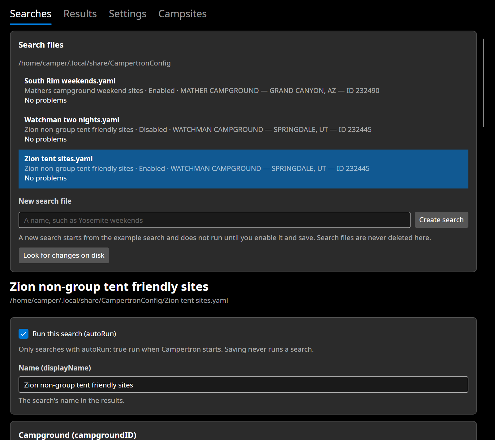
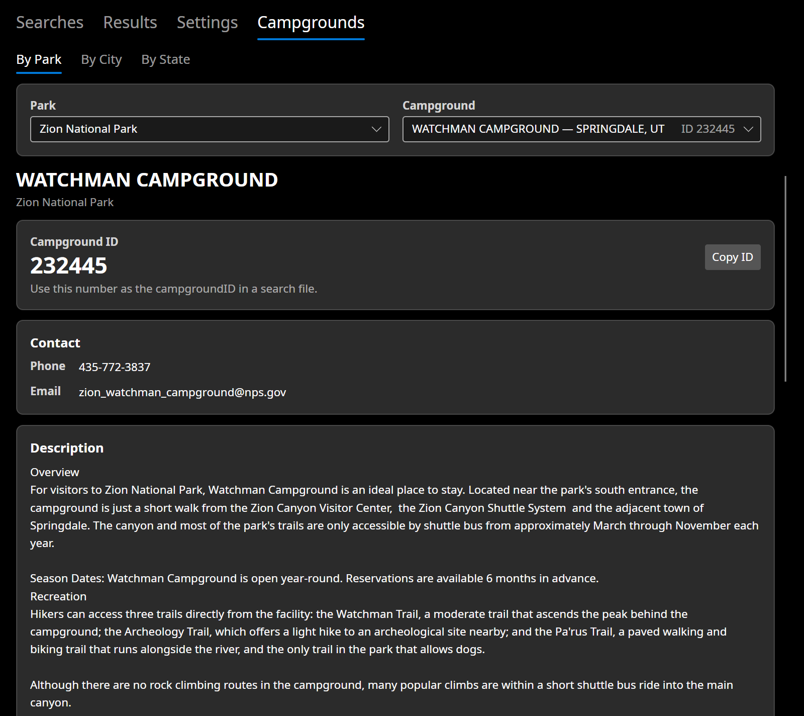
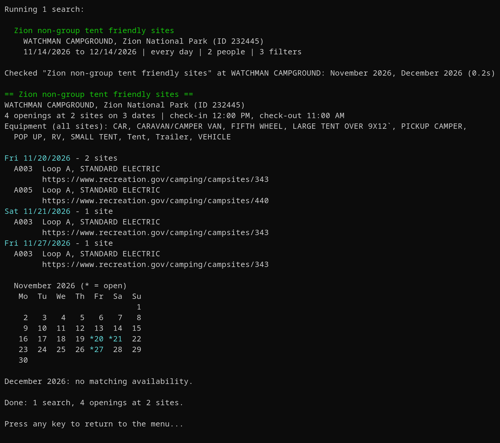
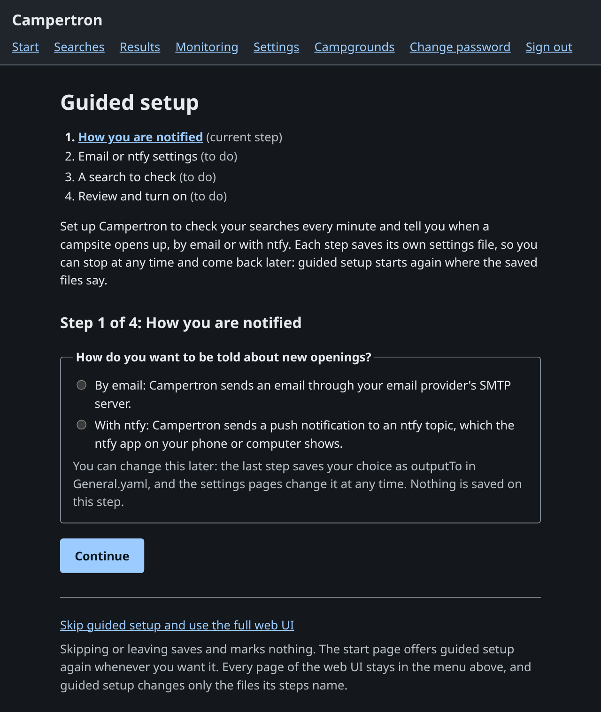
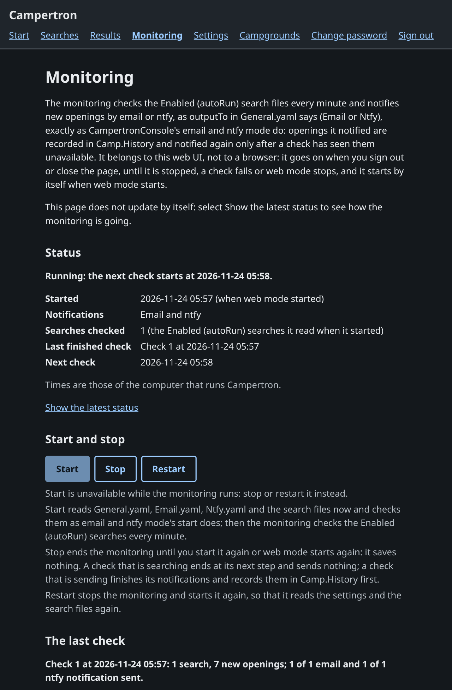

<div align="center">
  
</div>

# Campertron

Website: [campertron.com](https://campertron.com/)

Campertron watches [recreation.gov](https://www.recreation.gov) for campsites that open up at the campgrounds you choose, and tells you by email or with a push notification ([ntfy](https://ntfy.sh)).

Popular campgrounds are booked months ahead, but people cancel, and those openings are usually gone within minutes. Campertron checks your searches every minute and tells you about each new opening once; if a site is booked and then free again, for example after another cancellation, you hear about it again. You can also search whenever you like and see what is open right now.

It runs on Windows, macOS and Linux as a desktop app, in a terminal, in your web browser or as a Docker container. Campertron is free and open source (MIT license). It is not affiliated with Recreation.gov, and it doesn't book anything: you book on recreation.gov.

> **Versions:** this README describes the main branch, which is being prepared as version 0.3.0. Until 0.3.0 is released, the [latest release](https://github.com/ShaunAnthonyHathaway/Campertron/releases/latest) is 0.2.0, which has no web UI or guided setup, no test email or test notification, and no repeat notifications after a cancellation ([Upgrade or go back](#upgrade-or-go-back) lists every change). 0.2.0's own README is [at its tag](https://github.com/ShaunAnthonyHathaway/Campertron/blob/v0.2.0/README.md).

## Contents

- [What it does](#what-it-does) and [Choose how to use it](#choose-how-to-use-it)
- [Download and run](#download-and-run)
- [Set up your searches](#set-up-your-searches) and [Search now](#search-now)
- [Get notified](#get-notified): email, ntfy and the monitoring
- [The web UI](#the-web-ui) and [Run it with Docker](#run-it-with-docker)
- [Keep the campground list up to date](#keep-the-campground-list-up-to-date)
- [Security and privacy](#security-and-privacy), [Upgrade or go back](#upgrade-or-go-back), [Troubleshooting](#troubleshooting), [Known limitations](#known-limitations)
- [Quality and release process](#quality-and-release-process), [Questions and problems](#questions-and-problems)

## What it does

- **Searches** one or many campgrounds. Each search is a small settings file: the campground, the dates (days or months ahead, specific dates or a range), the days of the week, the group size, and optional filters for equipment, site features, site types, specific sites and a minimum number of nights in a row.
- **Searches now** and shows every open site that matches, each with a link to book it on recreation.gov.
- **Monitors around the clock:** checks your enabled searches every minute and sends new openings by email, as an ntfy push notification, or both.
- **Looks up campgrounds** by park, city or state: the campground ID a search needs, contact details, description, directions and fees.
- **Edits your searches and settings** in the desktop app or the web UI, checking each value as you go.

## Choose how to use it

There are two downloads, and all of them use the same settings folder, so you can mix them:

- **CampertronGUI, the desktop app** (Windows, macOS and Linux with a desktop): one window with **Searches**, **Results**, **Settings** and **Campgrounds** tabs. It runs searches when you ask and can send a test email or notification, but it never runs on its own and doesn't monitor.
- **CampertronConsole, the console** (any terminal): a menu to search now, refresh the campground list and view your configuration. With `outputTo: Email` or `outputTo: Ntfy` it starts monitoring instead of showing the menu.
- **The web UI** (`CampertronConsole --web`, version 0.3.0 or newer, part of every console download): the desktop app's features as web pages, which you open in a browser on your home network, plus a guided setup and the monitoring with **Start**, **Stop** and **Restart**.
- **Docker:** the console as a container image for `linux/amd64` and `linux/arm64`. It monitors by default, or runs the web UI with `--web`.

Which one should you use?

- **To be notified about openings and manage everything from a browser:** the web UI, on a computer that stays on or in Docker. Start with its guided setup.
- **To set up searches and check them on your own computer:** the desktop app; add the web UI or the console when you want notifications.
- **On a server without a browser:** the console's email or ntfy mode, or the container.



## Download and run

1. Open the [latest release](https://github.com/ShaunAnthonyHathaway/Campertron/releases/latest) and download the archive for your computer (see [Which file do I need?](#which-file-do-i-need)).
2. Extract it. You get one folder with everything inside; you don't need to install .NET or anything else.
3. Start a program from that folder:
   - **Windows:** double-click `CampertronGUI.exe` or `CampertronConsole.exe`.
   - **macOS and Linux:** in a terminal in that folder, run `./CampertronGUI` or `./CampertronConsole`. On macOS they are plain programs, not app bundles, so start them from Terminal.
   - **The web UI** (version 0.3.0 or newer): run `./CampertronConsole --web` (on Windows `.\CampertronConsole.exe --web`) and open the address it shows (see [The web UI](#the-web-ui)).

CampertronGUI needs a graphical desktop.

### Which file do I need?

Archive names follow `campertron-<program>-<version>-<platform>`, for example `campertron-console-0.2.0-win-x64.zip`. Choose `console` (the console and the web UI) or `gui` (the desktop app), then your platform:

| Your computer | Platform | File type |
|---|---|---|
| Windows, most PCs (64-bit Intel or AMD) | `win-x64` | `.zip` |
| Windows on ARM (for example Snapdragon laptops) | `win-arm64` | `.zip` |
| Windows, 32-bit | `win-x86` | `.zip` |
| Mac with Apple silicon (M1 or newer) | `osx-arm64` | `.tar.gz` |
| Mac with an Intel processor | `osx-x64` | `.tar.gz` |
| Linux, 64-bit Intel or AMD | `linux-x64` | `.tar.gz` |
| Linux, 64-bit ARM (for example Raspberry Pi with a 64-bit OS) | `linux-arm64` | `.tar.gz` |
| Linux, 32-bit ARM (for example Raspberry Pi with a 32-bit OS) | `linux-arm` | `.tar.gz` |

On Windows, extract a `.zip` in File Explorer (right-click, **Extract All**). On macOS and Linux, extract a `.tar.gz` in a terminal:

```sh
tar -xzf campertron-console-0.2.0-linux-x64.tar.gz
cd campertron-console-0.2.0-linux-x64
./CampertronConsole
```

### System requirements

- **Intel and AMD processors** (`win-x64`, `win-x86`, `linux-x64`, `osx-x64` and the `linux/amd64` image) need the x86-64-v2 instruction set (SSE4.2 and POPCNT), which practically every PC from the last decade has. On an older processor the program stops at startup with a message about missing instruction sets.
- **ARM processors** (`win-arm64`, `osx-arm64`, `linux-arm64`, `linux-arm`) have no such requirement. Raspberry Pi 3 and 4 may start a little more slowly.
- **The web UI** needs a current web browser; its pages also work without JavaScript and fit a phone's screen.
- **What is tested:** before each release, the `win-x64`, `win-arm64`, `osx-x64`, `osx-arm64`, `linux-x64` and `linux-arm64` downloads and both container images are started on machines of their own type. `win-x86` is run as a 32-bit program on 64-bit Windows, not on a 32-bit system, and `linux-arm` is built from the same code but not started. Avalonia, the desktop app's UI framework, supports 32-bit Windows commercially only and doesn't list 32-bit ARM Linux desktops.

### If your computer blocks the program

The programs are not code-signed, so your system may warn you the first time:

- **Windows:** SmartScreen may show a warning. Choose **More info**, then **Run anyway**.
- **macOS:** if Gatekeeper refuses to open a program, remove the download quarantine from the extracted folder and try again:

  ```sh
  xattr -dr com.apple.quarantine campertron-console-0.2.0-osx-arm64
  ```

### Verify your download

Each release has `SHA256SUMS.txt`. Download it next to your archive and run `sha256sum -c SHA256SUMS.txt --ignore-missing` (on macOS `shasum -a 256 <file>`, on Windows `Get-FileHash <file>` in PowerShell, then compare with the file's line). Each file also has a GitHub build attestation; with the [GitHub CLI](https://cli.github.com/):

```sh
gh attestation verify campertron-console-0.2.0-linux-x64.tar.gz --repo ShaunAnthonyHathaway/Campertron
```

## Set up your searches

### First start

The first start creates a settings folder (`CampertronConfig`) and a cache folder (`CampertronCache`) in:

- **Windows:** `C:\Users\<you>\AppData\Local`
- **macOS:** `~/Library/Application Support`
- **Linux:** `~/.local/share`, or `$XDG_DATA_HOME` if you set it
- **Docker:** `/config` and `/cache`, the folders you mount

**View Config** in the console and **Settings** > **System** in the desktop app show the exact place (the desktop app also has **Open settings folder**). The settings folder holds:

- `General.yaml` (where results go), `Email.yaml`, `Ntfy.yaml` and, for the web UI, `Web.yaml`;
- your searches, one `.yaml` file each, with any name;
- `RecreationDotOrg.db` (the campground list), `Camp.History` (what the monitoring has reported) and `Campertron.monitoring.lock`;
- for the web UI, `Web.password` (a hash of its password) and the folder `Web.keys`.

Keep the folder private: it can hold your email password and ntfy topic (see [Security and privacy](#security-and-privacy)).

The console's **Search** creates an example search, `ZionConfig.yaml` (tent sites at Watchman Campground in Zion National Park), the first time it finds no search file. Nothing else creates it, and Campertron changes a search file only when you save it.

### Create a search

In the desktop app's **Searches** tab or the web UI's **Searches** page:

1. Type a name under **New search file** and choose **Create search**. A new search starts from the example and is **Not enabled**.
2. Under **Campground**, type part of the campground's name, city, state, park or ID and choose it.
3. Set the dates, the days of the week, the number of people and any filters; the campground's own equipment types, sites, attributes and site types are offered as check lists. Problems are shown next to each setting, and a preview shows the lines a save will change.
4. Check **Enabled (autoRun)** and choose **Save**. Enabled searches are the ones the monitoring checks and the console's **Search** runs.
5. To try it now, select it on the **Results** tab or page and choose **Start**. This works for searches that aren't enabled too.

The monitoring reads the search files when it starts: restart it after a change (in the web UI, **Restart** on the **Monitoring** page).

To find a campground's ID, use the **Campgrounds** tab or page: choose a park, a city or a state, then the campground, and **Copy ID**.



You can also write search files by hand: copy an [example search](examples/0.1) into the settings folder, set `campgroundID`, the dates and the filters, and keep `autoRun: true`. The [settings reference](examples/0.1/README.md) explains every setting of a search file, `General.yaml`, `Email.yaml`, `Ntfy.yaml` and `Web.yaml`. A save in the desktop app or the web UI keeps your comments and leaves the previous version as `<name>.yaml.bak`.

### How filters match

An include list keeps a campsite that matches **any** of its values; an exclude list leaves out a campsite that matches **any** of its values; an empty list filters nothing. Attributes are written `Name:Value`, for example `Shade:Yes`.

- **`filterMatching: Exact`** (new searches): a value must equal the campsite's equipment type, name, attribute or site type.
- **`filterMatching: Contains`** (a search file without `filterMatching`): a site type matches when it contains the value (`GROUP` matches `GROUP STANDARD NONELECTRIC`), and an equipment or attribute value matches when it contains the campsite's (`RV/MOTORHOME` matches a campsite that allows `RV`).

Campsite names always match exactly, and letter case, spaces and punctuation always count.

## Search now

- **The console:** **Search** runs every enabled search once and lists the open sites by date (or by site, for several nights in a row), each with its booking link, followed by a calendar. With `outputTo: HtmlFile` it opens the results as a web page instead.
- **The desktop app and the web UI:** the **Results** tab or page runs the searches you select, enabled or not, when you choose **Start**, shows the progress and lets you **Cancel**. The web UI's page updates by itself while the search runs.



Searching now shows everything that matches right now, including openings you were already told about. It sends no notification, doesn't change what the monitoring has reported, and works while the monitoring runs. The **Results** tab and page list a month recreation.gov didn't answer as not checked, never as fully booked. In the web UI one search runs at a time, and its results stay in memory until your next run or until you sign out.

## Get notified

The monitoring checks your enabled searches every minute and notifies you of new openings. It runs in the console's email or ntfy mode, in the container, or in the web UI.

### Choose where results go

Set `outputTo` in `General.yaml` (in the desktop app or the web UI: **Settings** > **General.yaml**):

| `outputTo` | What happens |
|---|---|
| `Console` (default) | The console's **Search** shows the results in the terminal. No monitoring. |
| `HtmlFile` | The console's **Search** opens the results as a web page. No monitoring. |
| `Email` | Monitoring: one email for each search with new openings, and ntfy notifications too while `Ntfy.yaml` has `enabled: true`. |
| `Ntfy` | Monitoring with ntfy notifications only; `Email.yaml` isn't used. |

For example:

```yaml
outputTo: Email
refreshRidbDataDayInterval: 30
lastRidbDataRefresh: 2026-11-01T00:00:00Z
autoRefresh: false
```

### How the monitoring runs

- **The console:** with `outputTo: Email` or `Ntfy`, `CampertronConsole` starts monitoring right away, without the menu, until you press Ctrl+C or a problem stops it.
- **Docker:** the container's default, without `--web` (see [Run it with Docker](#run-it-with-docker)).
- **The web UI:** starts the monitoring by itself whenever web mode starts with `outputTo` set to `Email` or `Ntfy`; its **Monitoring** page shows it and has **Start**, **Stop** and **Restart**. It keeps running when you sign out or close the page.

Each start reads the settings, the password or token and the search files once. It refuses to start, with one error that says what to fix, when there is no enabled search with a campground, `Email.yaml` is incomplete, `Ntfy.yaml` can't be used, or a password or token source can't be read. Restart the monitoring after you change a search or a setting.

Only one Campertron can monitor a settings folder at a time, so you never get every notification twice: a second console, container or web UI on the same folder refuses to start its monitoring. Searching now isn't affected.

If a notification can't be sent, the monitoring stops after that check with an error that says why, and the openings it couldn't deliver are reported again at the next start (with email and ntfy both on, what one of them delivered isn't sent again). The console exits with code 1, so a service or container set to restart on failure starts it again; the web UI shows the error on its **Monitoring** page and waits for **Start**.

### Cancellations and repeat notifications

The monitoring records each campsite and night it has told you about in the `Camp.History` folder in the settings folder:

- An opening is reported once and not again while it stays available, also after a restart.
- Once a completed check has seen that night booked or otherwise unavailable, Campertron forgets it, so you are notified again if it opens up again, for example after another cancellation. Versions 0.2.0 and earlier never report it again.
- A night that was booked and freed again between two checks, or whose month wasn't checked, looks continuously available and isn't reported again. Only a status of exactly `Available` counts, and Campertron doesn't count how many places are left at a site several groups can book.
- A stay of several nights in a row (`consecutiveDays`) is reported whole when any of its nights is new.
- An opening is recorded only after a notification about it was delivered.

To be told about everything that is open now, stop the monitoring and delete the `Camp.History` folder.

### Email settings

`Email.yaml` holds your email provider's SMTP settings; the connection is always encrypted, and many providers require an app password instead of your normal one:

```yaml
smtpServer: smtp.example.com
smtpPort: 587
smtpUsername: you@example.com
smtpPassword: your-password-or-app-password
sendToAddressList:
- you@example.com
sendFromAddress: you@example.com
```

Each email shows one search's openings grouped by date, with booking links, and includes a plain-text version. When there are too many to show in one email (from about a hundred open sites), it gives a summary and attaches the full results as an HTML file.

### The email password

Campertron takes the SMTP password from the first of these you set up. If it can't use that one, the monitoring stops with an error instead of trying the next:

1. **A password file** named by `smtpPasswordFile` (recommended; for example a Docker secret). The whole file is the password.
2. **The environment variable `CAMPERTRON_EMAIL_PASSWORD`**, where the monitoring runs.
3. **`smtpPassword`** in `Email.yaml`, as plain text.

```yaml
smtpServer: smtp.example.com
smtpPort: 587
smtpUsername: you@example.com
smtpPassword: ''
smtpPasswordFile: /run/secrets/smtp_password
sendToAddressList:
- you@example.com
sendFromAddress: you@example.com
```

Write the file's full path, and let only the user that runs Campertron read it (for example `chmod 600`). [The notification examples](examples/notifications/README.md#the-secret-files) show how to create it without leaving the password in your shell history. Anyone who can inspect the process or the container can read an environment variable (for example with `docker inspect`), so prefer the file. Campertron reads the password when the monitoring starts, never shows or logs it, and doesn't encrypt it.

### Notifications with ntfy

[ntfy](https://ntfy.sh) shows push notifications on your phone or computer: Campertron publishes to a *topic* on an ntfy server, and the ntfy app, subscribed to that topic, shows them. Use the public server `https://ntfy.sh` or your own. Set it up under **Settings** > **Ntfy.yaml** in the desktop app or the web UI (or in the web UI's guided setup), or create `Ntfy.yaml` in the settings folder:

```yaml
enabled: true
server: https://ntfy.sh
topic: campertron-<random>
```

- **Keep the topic secret.** On a server without access control, such as `ntfy.sh` without an account, anyone who knows the topic can read your notifications and send to it. **Generate a random topic** gives you a long random one; Campertron refuses the placeholder `campertron-<random>`. Subscribe to the new topic in the ntfy app after you save it.
- **Use `https://`.** With `http://`, the topic, the token and every message cross the network unencrypted; Campertron accepts it for a network you trust, with a warning.
- **An access token**, for a server or topic that needs one, comes from a file named by `tokenFile` or from the environment variable `CAMPERTRON_NTFY_TOKEN`, never from `Ntfy.yaml` itself. A user name and password aren't supported.
- **Optional settings** (`priority`, `tags`, `timeoutSeconds`) are in the [settings reference](examples/0.1/README.md).

Each check sends one notification for each search with new openings; tapping it opens the campground on recreation.gov. The public `ntfy.sh` keeps messages for some hours and, to reach Android phones, passes them through Google's Firebase service ([ntfy's FAQ](https://docs.ntfy.sh/faq/)).

### Test email and test notification

**Send a test email** (under **Settings** > **Email.yaml**) and **Send a test notification** (under **Settings** > **Ntfy.yaml**), in the desktop app, the web UI and the guided setup, send one message with the saved settings and say whether the server accepted it. They read the password or token only for that message, work whatever `outputTo` is, and record and change nothing. A test shows whether *that* program can reach the server: the desktop app on your laptop may see other files and variables than a container on your server.

Ready-made settings for each way to be notified, and a Docker Compose file with secrets, are in [examples/notifications](examples/notifications/README.md).

## The web UI

The web UI needs version 0.3.0 or newer. `CampertronConsole --web` serves Campertron's own pages to your browser and uses the same settings folder as the desktop app and the console.

### Start it

```sh
./CampertronConsole --web
```

On Windows: `.\CampertronConsole.exe --web`. Web mode listens on port 8790 on **every network interface**, so other devices on your network can open `http://<this computer's name or address>:8790/`; on the same computer, open `http://localhost:8790/`. To keep it to this computer, or to use another port:

```sh
./CampertronConsole --web --listen 127.0.0.1 --port 8791
```

The first time, web mode writes a one-time **setup code** to its output (in Docker, to `docker logs`). Open the web UI, enter the code and choose a password of 10 to 128 characters, then sign in. The code is valid for 30 minutes and for one use; a restart of web mode writes a new one. If you forget the password, stop web mode, delete `Web.password` in the settings folder and start it again.

When `outputTo` is `Email` or `Ntfy` and your settings are complete, web mode also starts the monitoring. Otherwise it waits for you to set things up. Stop it with Ctrl+C, or by stopping its service or container.

### Guided setup

When nothing is set up yet, you land on the **guided setup** after signing in: choose email or ntfy, enter its settings (and send a test), create a first search, and turn the monitoring on. Each step saves the same files as the **Settings** and **Searches** pages, so you can leave and come back where your saved files say. **Skip guided setup** takes you to the full web UI, and the **Start** page offers guided setup again at any time. The desktop app has no guided setup.



### The pages

The menu has **Start**, **Searches**, **Results**, **Monitoring**, **Settings** (the four settings files and **System**) and **Campgrounds**, with **Change password** and **Sign out**. The pages match the desktop app's tabs, with the same words and checks. **Monitoring** shows whether the monitoring runs, why it stopped, the last and the next check and the last check's new openings. **Settings** > **System** chooses the theme (System, Light or Dark, kept by your browser), shows the current configuration and refreshes the campground data. The **Results**, **Monitoring** and **System** pages update by themselves while their search, monitoring or refresh runs.



### Keep it safe on your network

The web UI is made for a home network you trust:

- **It speaks plain HTTP.** Whoever can watch your network traffic can read the password and the session. A password doesn't make it safe to open to the Internet: don't forward a port of your router to it.
- **It listens on every network interface by default.** If you use it only on the computer it runs on, start it with `--listen 127.0.0.1` (in Docker, publish the port as `127.0.0.1:8790:8790`).
- **The password is on by default.** If you turn it off (`passwordProtection: false` in `Web.yaml`), everyone who can reach the web UI can change your settings, searches and notifications.
- **For HTTPS, put it behind a reverse proxy you run** and keep the web UI itself off the network: list the proxy in `trustedProxies` and its host name in `allowedHosts` in `Web.yaml` (see [the web UI guide](docs/web-ui.md#https-through-a-reverse-proxy)). Campertron has no HTTPS server of its own.

It answers only to its own names (an IP address, `localhost`, the computer's name and those in `allowedHosts`), limits sign-in attempts and writes failed sign-ins to its output. A session ends when you sign out, after 8 hours without use, after 7 days, or when web mode restarts.

[The web UI guide](docs/web-ui.md) covers the command-line options, the password, `Web.yaml`, reverse proxies, sessions and the health check.

## Run it with Docker

The console is published on the [GitHub Container Registry](https://github.com/ShaunAnthonyHathaway/Campertron/pkgs/container/campertronconsole) as `ghcr.io/shaunanthonyhathaway/campertronconsole`, for `linux/amd64` and `linux/arm64`. In the commands below, replace `<version>` with a version, such as `0.2.0`; the web UI needs `0.3.0` or newer.

The container needs two folders from your computer, and refuses to start without them:

- `/config`, the settings folder: your settings, searches, `Camp.History` and the campground list. Back it up.
- `/cache`, the cache: a refresh of the campground data downloads into it and needs about 1.15 GB free while it runs.

The container runs as user ID 1654, so make the folders writable for it:

```sh
mkdir -p ~/campertron/config ~/campertron/cache
chmod -R a+rwX ~/campertron
```

`chmod a+rwX` lets every user of the computer read and write them; on a computer you share, give only user ID 1654 access instead, for example `setfacl -R -m u:1654:rwX ~/campertron` (or `sudo chown -R 1654 ~/campertron`).

### The web UI in Docker

```sh
docker run -d --name campertron \
  --volume ~/campertron/config:/config \
  --volume ~/campertron/cache:/cache \
  --publish 8790:8790 \
  ghcr.io/shaunanthonyhathaway/campertronconsole:<version> --web
```

Read the setup code with `docker logs campertron`, then open `http://<the computer's name or address>:8790/`. To keep the web UI to the computer Docker runs on, publish `127.0.0.1:8790:8790` instead. With Docker Compose (`docker compose up -d`, then `docker compose logs` for the code):

```yaml
services:
  campertron:
    image: ghcr.io/shaunanthonyhathaway/campertronconsole:<version>
    command: ["--web"]
    restart: on-failure:3
    ports:
      - "8790:8790"
    volumes:
      - ~/campertron/config:/config
      - ~/campertron/cache:/cache
    healthcheck:
      test: ["CMD", "dotnet", "CampertronConsole.dll", "--healthcheck"]
```

The health check shows only that the web UI answers, not whether the monitoring runs. Don't run this container and the monitoring container below on the same `/config` at the same time: only one of them can monitor it.

### The monitoring without a web UI

Put `General.yaml` with `outputTo: Email` or `Ntfy`, `Email.yaml` or `Ntfy.yaml`, and at least one enabled search in `~/campertron/config` (the desktop app or the web UI can create them), then:

```sh
docker run -d --name campertron \
  --volume ~/campertron/config:/config \
  --volume ~/campertron/cache:/cache \
  ghcr.io/shaunanthonyhathaway/campertronconsole:<version>
```

`docker logs -f campertron` shows one line for every check and notification. If the container stops right after it starts, `docker logs campertron` says why.

### Secrets in Docker

Mount the SMTP password file or the ntfy token file read-only, for example `--volume ~/campertron-secrets/smtp_password:/run/secrets/smtp_password:ro`, and write that path in `smtpPasswordFile` (or `tokenFile`); the file must be readable for user ID 1654. [examples/notifications](examples/notifications/README.md#docker-with-read-only-secret-mounts) shows `docker run` and Docker Compose with both secrets. Don't put a password or token in a Compose file or on a command line, and prefer files to container variables, which `docker inspect` shows.

### Unraid

There is no Community Applications template yet. Add the container yourself: the image above, a **Path** for `/config` and one for `/cache`, any secret files as read-only **Path**s, and for the web UI `--web` as **Post Arguments** (advanced view) and the port `8790`. User ID 1654 must be able to write to both folders and read the secrets.

### Image tags

Each version is tagged with its exact number, such as `0.2.0`: use it to stay on one version. A stable version is also tagged with its major and minor number, such as `0.2`, and with `latest`; these only ever move forward to a newer stable version. Pre-release versions get only their exact tag.

## Keep the campground list up to date

Campertron comes with a copy of recreation.gov's campground list. To download the latest one (about 570 MB; it takes several minutes):

- **Console:** choose **Refresh Ridb Data (slow)** in the menu.
- **Desktop app and web UI:** **Settings** > **System** > **Refresh campground data…**, then **Start refresh**.

Your settings and searches stay as they are. You can cancel until the new data is being installed, and a refresh that fails or is canceled leaves the current data. A refresh needs about 1.15 GB of free disk space while it runs (in Docker, in `/cache`), and Campertron doesn't check the free space first.

Afterwards the desktop app restarts itself. Restart web mode (or its container) yourself so that every page uses the new data; the web UI's monitoring pauses during the web UI's own refresh and starts again after it. `autoRefresh: true` in `General.yaml` refreshes when the console or the desktop app starts, every `refreshRidbDataDayInterval` days; the web UI and the container never refresh by themselves.

## Security and privacy

- **Your settings folder can hold secrets:** the SMTP password, if you keep it in `Email.yaml`, and the ntfy topic. Keep the folder private, and prefer a password file for the password (see [The email password](#the-email-password)).
- **Campertron keeps its secrets out of sight:** its output and logs never contain the password, the token or the topic, and **View Config** shows nothing of `Email.yaml` or `Ntfy.yaml`. The desktop app and the web UI show the topic only in their `Ntfy.yaml` form; the desktop app shows a plain-text password only when you choose **Show password**, and the web UI never shows it.
- **Backups:** saving a settings file keeps the previous version as `<name>.bak`. A save that replaces or removes the plain-text SMTP password or the ntfy topic writes the backup without it. A backup saved by version 0.2.0 or earlier can still hold an old password or topic: saving that file again replaces it, and you can delete `Email.yaml.bak` or `Ntfy.yaml.bak` if you don't need it. Deleting or replacing a file doesn't securely erase it from the disk.
- **The web UI** is made for a network you trust: see [Keep it safe on your network](#keep-it-safe-on-your-network).

## Upgrade or go back

### From 0.2.0 to 0.3.0

Use the new download in place of the old folder, or the new image. Your settings folder works as it is, and you don't need to edit anything. What changes:

- **Repeat notifications:** an opening you were told about is reported again once a check has seen it booked and then free again. What 0.2.0 recorded counts as notified.
- **One monitoring for a settings folder:** 0.2.0 doesn't take this lock, so stop the old version's console or container before you start the new one.
- **The web UI** is new and starts only with `--web`; the console and the container start as before without it.
- **Docker:** the image is based on the ASP.NET Core runtime and is larger, and a refresh of the campground data now downloads into `/cache` (about 1.15 GB free while it runs).
- **New files** in the settings folder: `Campertron.monitoring.lock`, and once you use the web UI, `Web.password`, `Web.keys` and, if you save its settings, `Web.yaml`.
- **Old backups:** an `Email.yaml.bak` or `Ntfy.yaml.bak` that 0.2.0 or earlier saved can still hold a password or topic you replaced; save the file once, or delete the backup (see [Security and privacy](#security-and-privacy)).

### Going back to 0.2.0

Move `Web.yaml` out of the settings folder first, if you saved one: 0.2.0 takes it for a search file. The other new files can stay. With Docker, use the image tag `0.2.0` or `0.2`, not `latest`. Version 0.2.0 reads what 0.3.0 recorded in `Camp.History` and keeps suppressing it, also after a cancellation.

### From 0.1.1 or older

Also follow the 0.2.0 notes on [upgrading from 0.1.1 and going back](https://github.com/ShaunAnthonyHathaway/Campertron/releases/tag/v0.2.0).

## Troubleshooting

- **The console or container stops right after it starts (exit code 1):** the error says what to fix, for example no enabled search with a campground ID, a password or token source it can't use, an `Ntfy.yaml` it can't use, or another Campertron already monitoring the settings folder. A service or container set to always restart repeats the error until it is fixed. The web UI keeps running and shows the reason on its **Monitoring** page.
- **A settings file can't be read:** Campertron names the file and where the problem is. The console exits with code 1; the desktop app shows the problem and **Try again**.
- **recreation.gov reports too many requests:** the console waits five minutes and exits with code 1; the desktop app and the web UI stop the search or check, and **Start** waits five minutes.
- **The web UI refuses forms behind a reverse proxy:** set `trustedProxies` and `allowedHosts` ([the web UI guide](docs/web-ui.md#https-through-a-reverse-proxy)).
- **Logs:** the console writes plain text, with color only in a terminal (set `NO_COLOR` to turn it off); warnings and errors go to the error output. The menu needs a terminal: for a service or a log file, use email or ntfy mode or the web UI, which write one line for each check and notification.

## Known limitations

- Campertron finds openings; it doesn't book them, and an opening can be gone before you book it.
- It relies on recreation.gov's public data, which can change at any time, and on a copy of the campground list that gets older until you refresh it.
- Email, ntfy and recreation.gov were tested against local stand-ins, not real servers. The web UI's own tests run on Linux; on Windows and macOS the release checks only start it and check its answers.
- The web UI has one password and no HTTPS of its own; several users and an installable app aren't supported yet.
- The desktop app doesn't monitor and has no guided setup.
- Email and ntfy are the only notifications; other services (such as webhooks, Gotify, Discord, Telegram or Pushover) aren't supported.
- The programs aren't code-signed, the macOS programs aren't notarized, and there are no installers.

## Quality and release process

Campertron was originally created and remains maintained by Shaun Hathaway. AI coding tools, including Claude Code, have been used extensively in its recent modernization and feature development, under the maintainer's direction; since November 2026, commits made with Claude Code name it as a co-author. The maintainer remains responsible for the project's scope and for release decisions.

- Every change reaches the main branch through a pull request that can be merged only after an automated check has built Campertron, run all of its tests and found no known vulnerable package.
- Every release is built by the repository's release workflow from a version tag. Before publishing, it starts the downloads and both container images as described under [System requirements](#system-requirements). These checks show that the released programs start, answer and stop on each platform; they don't sign in, search or send notifications there.
- Release tags can't be moved, and a published release's files can't be replaced. Each file has a checksum and a build attestation (see [Verify your download](#verify-your-download)).

## Questions and problems

Found a bug, or something doesn't work as described? Please [open an issue](https://github.com/ShaunAnthonyHathaway/Campertron/issues) with:

- the output of `CampertronConsole --version` (in the desktop app, **Copy** under **Settings** > **System** > **Current configuration**);
- your operating system and processor (for example Windows 11 on Arm), and whether you used the desktop app, the console, the web UI or Docker;
- what you did, what you expected and what happened instead, with any error message.

Don't post your `Email.yaml`, `Ntfy.yaml` or their `.bak` backups, your password or token files, `Web.password`, the `Web.keys` folder or a setup code, and remove passwords, tokens, topics and email addresses from anything you share.

Campertron is not affiliated with or endorsed by Recreation.gov.

## License

Campertron is released under the [MIT License](LICENSE).
