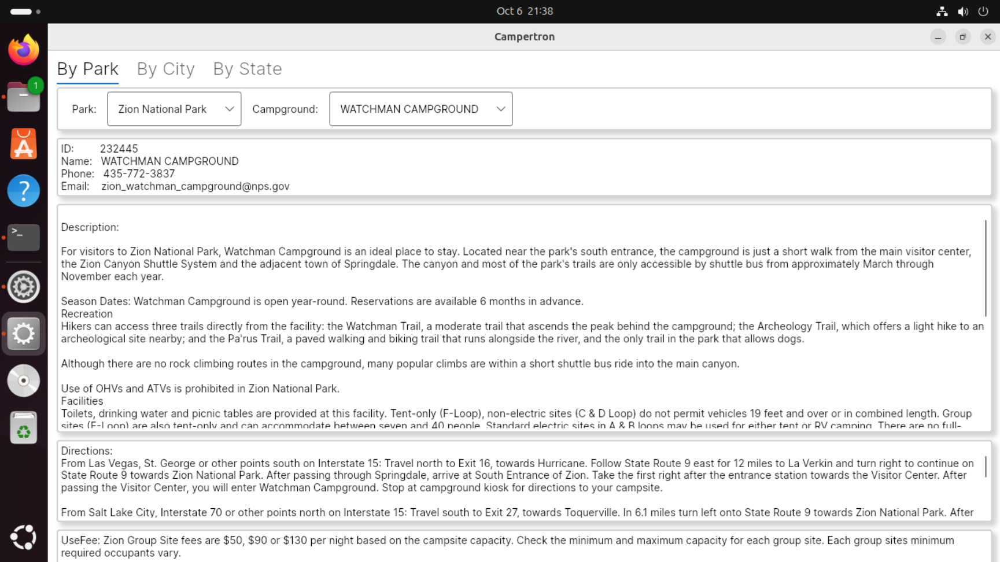
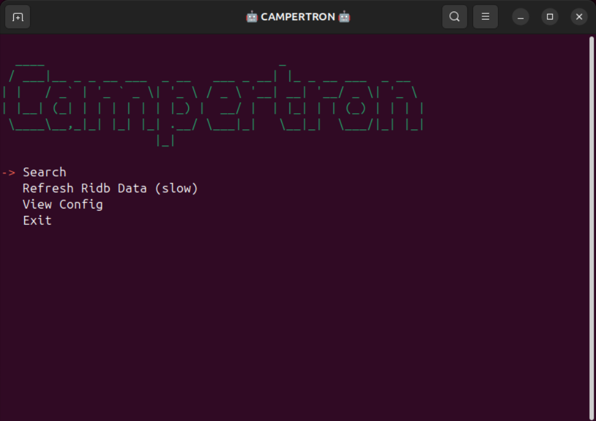
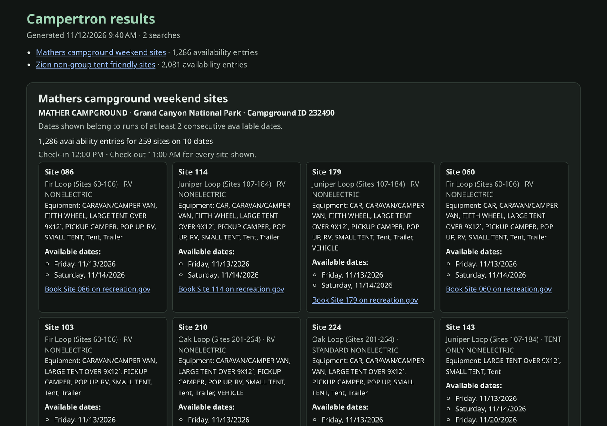
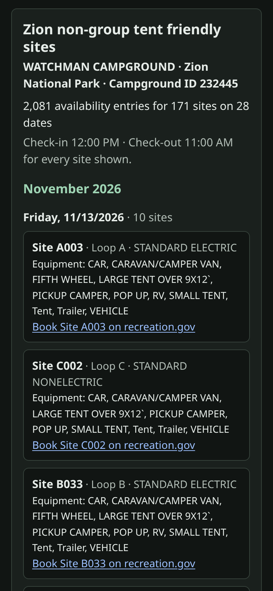
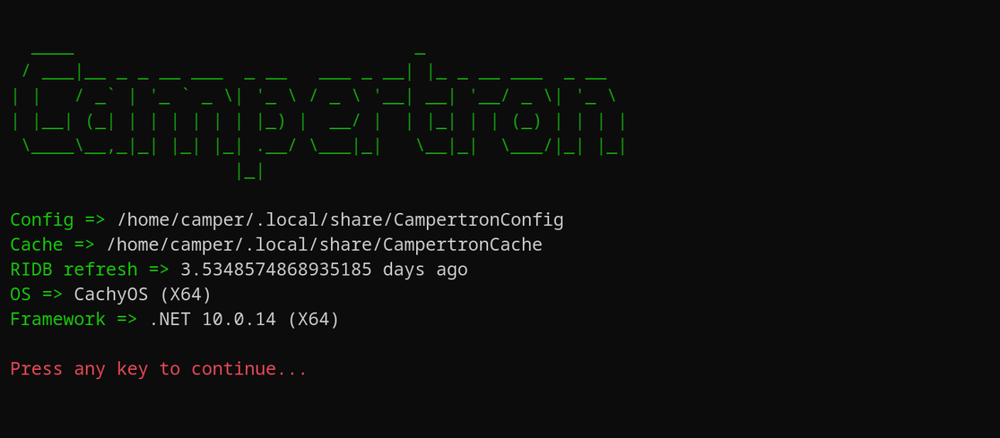
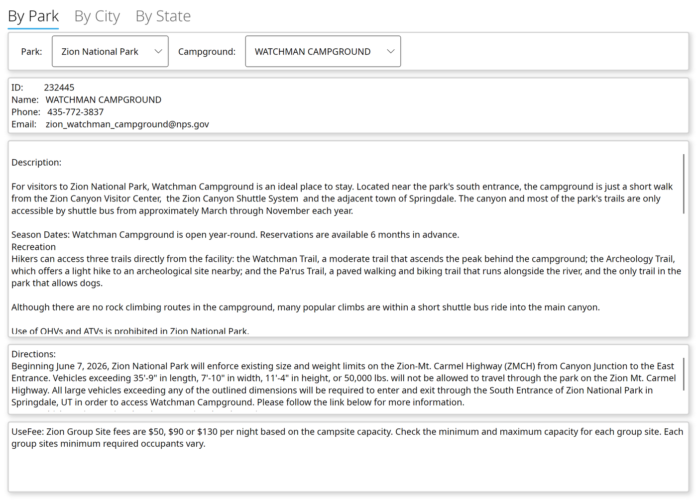

<div align="center">
  
</div>

# Campertron

Campertron watches [recreation.gov](https://www.recreation.gov) for campsites that open up at the campgrounds you care about.

Popular campgrounds are booked months ahead, but people cancel all the time, and those openings are usually gone again within minutes. Campertron checks for you and shows you the sites that match your plans: in a terminal window, in your web browser, or by email.

It runs on Windows, macOS and Linux, or as a Docker container. Campertron is free and open source (MIT license).

## What you can do with it

- Search one or many campgrounds at once. Each search is a small settings file, and Campertron runs all of them together.
- Narrow the results to what you need:
  - dates: a number of days or months ahead, specific dates, a date range, or up to a date
  - days of the week
  - group size
  - equipment, such as a tent or a trailer
  - site features, such as shade or campfires allowed
  - site types and specific sites
  - a minimum number of consecutive nights
- Get the results in the terminal, as a web page in your browser, or by email. In email mode Campertron keeps running, waits a minute between checks and emails you whenever it finds openings it hasn't reported before.
- Look up any campground's ID, phone number, description, directions and fees in the desktop app.

## Two programs: Console and GUI

Campertron comes as two separate downloads. Most people use both.

| | **CampertronConsole** | **CampertronGUI** |
|---|---|---|
| What it does | Searches recreation.gov for open campsites and shows or emails the matches | Lets you browse campgrounds by park, city or state and see their details |
| Use it to | run your searches and get notified | find the campground ID a search needs |
| How it runs | in a terminal window, or as a Docker container | as a desktop window |

The GUI does not search for open campsites. It helps you set up searches for the console.

## Screenshots

**CampertronConsole** opens with a short menu. Use the arrow keys and press Enter.



**Search** runs every search you have set up and lists the open sites it found, with the dates, a calendar and a link to book the site on recreation.gov.



With `outputTo: HtmlFile`, **Search** opens the results as one web page instead: a section for each search, the open sites grouped by date (or by site when you ask for consecutive nights), and a link to book each site. The page follows your system's light or dark theme and also fits a phone screen. Email output sends the same kind of page.





**View Config** shows where your settings files are stored.



**CampertronGUI** lets you pick a park, a city or a state, then a campground, and shows its ID and details. The ID is what you put in a search: select it, or press **Copy ID**. The GUI follows your system's light or dark theme.



## Download and run

1. Open the [latest release](https://github.com/ShaunAnthonyHathaway/Campertron/releases/latest) and download the archive for your computer (see the table below).
2. Extract it. You get one folder with everything inside.
3. Start the program from that folder:
   - **Windows:** double-click `CampertronConsole.exe` or `CampertronGUI.exe`.
   - **macOS and Linux:** open a terminal in the folder and run `./CampertronConsole` or `./CampertronGUI`.

You don't need to install .NET or anything else. Each download includes everything it needs.

### Which file do I need?

Archive names follow the pattern `campertron-<program>-<version>-<platform>`: for example `campertron-console-0.1.0-beta.8-win-x64.zip`. Pick `console` or `gui`, then your platform:

| Your computer | Platform in the file name | File type |
|---|---|---|
| Windows, most PCs (64-bit Intel or AMD) | `win-x64` | `.zip` |
| Windows on ARM (for example Snapdragon laptops) | `win-arm64` | `.zip` |
| Windows, 32-bit | `win-x86` | `.zip` |
| Mac with Apple silicon (M1 or newer) | `osx-arm64` | `.tar.gz` |
| Mac with an Intel processor | `osx-x64` | `.tar.gz` |
| Linux, 64-bit Intel or AMD | `linux-x64` | `.tar.gz` |
| Linux, 64-bit ARM (for example Raspberry Pi with a 64-bit OS) | `linux-arm64` | `.tar.gz` |
| Linux, 32-bit ARM (for example Raspberry Pi with a 32-bit OS) | `linux-arm` | `.tar.gz` |

On Windows, extract a `.zip` from File Explorer (right-click, **Extract All**). On macOS and Linux, extract a `.tar.gz` in a terminal, for example:

```sh
tar -xzf campertron-console-0.1.0-beta.8-linux-x64.tar.gz
cd campertron-console-0.1.0-beta.8-linux-x64
./CampertronConsole
```

CampertronGUI needs a graphical desktop. On macOS it is a plain program rather than an app bundle, so start it from Terminal.

### If your computer blocks the program

The programs are not code-signed, so your system may warn you the first time:

- **Windows:** SmartScreen may show a warning. Choose **More info**, then **Run anyway**.
- **macOS:** if Gatekeeper refuses to open the program, remove the download quarantine from the extracted folder and try again:

  ```sh
  xattr -dr com.apple.quarantine campertron-console-0.1.0-beta.8-osx-arm64
  ```

## Set up your searches

### First start

The first time either program starts, it creates two folders for its files:

| System | Settings (`CampertronConfig`) and cache (`CampertronCache`) are in |
|---|---|
| Windows | `C:\Users\<you>\AppData\Local` |
| macOS | `~/Library/Application Support` |
| Linux | `~/.local/share` (or `$XDG_DATA_HOME` if you set it) |

You can always check the exact location with **View Config** in the console menu.

The settings folder holds:

- `General.yaml`: general options, including where results go.
- `Email.yaml`: your email settings, used only for email notifications.
- Your searches: one `.yaml` file per search, with any file name.
- `RecreationDotOrg.db`: Campertron's copy of the recreation.gov campground list, which the GUI and the searches use.

The first time you choose **Search** without any searches set up, Campertron creates an example, `ZionConfig.yaml`, which looks for tent sites at Watchman Campground in Zion National Park. Use it as a starting point.

### Create a search

1. Open CampertronGUI and find your campground under **By Park**, **By City** or **By State**. Note its **ID**.
2. Copy `ZionConfig.yaml` (or one of the [example searches](examples/0.1)) to a new file in the settings folder, for example `MyTrip.yaml`.
3. Edit it: give it a `displayName`, set `campgroundID` to the ID from the GUI, and adjust the dates and filters.
4. Keep `autoRun: true`. Only searches with `autoRun: true` are run.

The [examples page](examples/0.1) explains every setting in a search file.

### Choose where results go

Set `outputTo` in `General.yaml`:

| `outputTo` | What happens |
|---|---|
| `Console` (default) | Choose **Search** in the menu. Results appear in the terminal. |
| `HtmlFile` | Choose **Search** in the menu. The results of all your searches open as one web page in your browser. |
| `Email` | Campertron starts searching right away, without the menu. It keeps running, waits a minute between checks and emails you when it finds openings it hasn't reported before: one email per search, with the results as a web page. Fill in `Email.yaml` first. |

`Email.yaml` uses your email provider's SMTP settings (the connection is always encrypted):

```yaml
smtpServer: smtp.example.com
smtpPort: 587
smtpUsername: you@example.com
smtpPassword: your-password-or-app-password
sendToAddressList:
- you@example.com
sendFromAddress: you@example.com
```

Many providers require an app password for this instead of your normal password.

### Keep the campground list up to date

Campertron ships with a copy of the recreation.gov campground list. To download the latest one, choose **Refresh Ridb Data (slow)** in the console menu. It downloads about 570 MB, so it can take a few minutes. To refresh automatically, set `autoRefresh: true` in `General.yaml`; `refreshRidbDataDayInterval` sets how many days to wait between refreshes.

## Run it with Docker

The console is also available as a container image for 64-bit Intel/AMD (`linux/amd64`) and ARM (`linux/arm64`) systems. The container sends results by email only, so it suits a server or home lab that runs Campertron around the clock.

1. Install Docker by following the [official guide](https://docs.docker.com/engine/install/), then download the image:

   ```sh
   docker pull ghcr.io/shaunanthonyhathaway/campertronconsole:0.1.0-beta.8
   ```

2. Create a settings folder and a cache folder. The container runs as a regular user, so make the folders writable for it:

   ```sh
   mkdir -p ~/campertron/config ~/campertron/cache
   chmod -R a+rwX ~/campertron
   ```

3. Put your settings files in `~/campertron/config`:
   - `General.yaml` with email output:

     ```yaml
     outputTo: Email
     refreshRidbDataDayInterval: 30
     lastRidbDataRefresh: 2026-11-01T00:00:00Z
     autoRefresh: false
     ```

   - `Email.yaml` with your email settings (see [Choose where results go](#choose-where-results-go)).
   - One or more search files, for example a copy of the [Zion example](examples/0.1/ZionConfig.yaml) with your own campground ID.

4. Start the container:

   ```sh
   docker run -d --name campertron \
     --volume ~/campertron/config:/config \
     --volume ~/campertron/cache:/cache \
     ghcr.io/shaunanthonyhathaway/campertronconsole:0.1.0-beta.8
   ```

   On its first start the container adds the campground list (`RecreationDotOrg.db`) to your settings folder. To see what it is doing, run `docker logs -f campertron`.

Inside the container, `/config` holds the settings and `/cache` holds temporary files. Campertron's container images are published on the [GitHub Container Registry](https://github.com/ShaunAnthonyHathaway/Campertron/pkgs/container/campertronconsole). Beta versions are tagged only with their exact version number, such as `0.1.0-beta.8`; there is no `latest` tag until a stable version is released.

## Verify your download

If you want to make sure a download is complete and really comes from this project, check it against the published checksums and build records.

Each release includes `SHA256SUMS.txt`. Download it next to your archive and run:

```sh
sha256sum -c SHA256SUMS.txt --ignore-missing
```

On Windows, run `Get-FileHash <file>` in PowerShell; on macOS, run `shasum -a 256 <file>`. Then compare the result with the line for that file in `SHA256SUMS.txt`.

Each file also has a GitHub build attestation, which shows that it was built from this repository by its release workflow. With the [GitHub CLI](https://cli.github.com/) installed, run:

```sh
gh attestation verify campertron-console-0.1.0-beta.8-linux-x64.tar.gz --repo ShaunAnthonyHathaway/Campertron
```

## Questions and problems

Found a bug, or something doesn't work as described? Please [open an issue](https://github.com/ShaunAnthonyHathaway/Campertron/issues). Include your operating system and the output of `CampertronConsole --version`, which prints the Campertron version and the .NET version it runs on.

## License

Campertron is released under the [MIT License](LICENSE).
