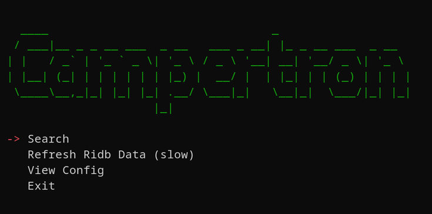

<div align="center">
  
</div>

# Campertron

Website: [campertron.com](https://campertron.com/)

Campertron watches [recreation.gov](https://www.recreation.gov) for campsites that open up at the campgrounds you care about.

Popular campgrounds are booked months ahead, but people cancel all the time, and those openings are usually gone again within minutes. Campertron checks every minute and tells you by email or with a push notification ([ntfy](https://ntfy.sh)) when a site that matches your search becomes available, once for each opening: a site and night you were told about is reported again only after Campertron has seen it booked and then free again, for example after another cancellation (see [Cancellations and repeat notifications](#cancellations-and-repeat-notifications)). You can also search whenever you like and see what is open right now.

It runs on Windows, macOS and Linux, or as a Docker container, as a desktop app, in a terminal or in your web browser. Campertron is free and open source (MIT license), and it is not affiliated with Recreation.gov. [Quality and release process](#quality-and-release-process) describes how it is built, tested and released.

> **Versions.** This README describes Campertron as it is on its main branch. Features marked **new in version 0.3.0**, such as the web UI, need version 0.3.0 or newer: if the [latest release](https://github.com/ShaunAnthonyHathaway/Campertron/releases/latest) is older, they are not in a release yet.

## Contents

- [What you can do with it](#what-you-can-do-with-it)
- [Choose how to use it](#choose-how-to-use-it): the desktop app, the console and the web UI
- [Download and run](#download-and-run)
- [A quick tour](#a-quick-tour)
- [Set up your searches](#set-up-your-searches)
- [Results and notifications](#results-and-notifications): searching now, monitoring around the clock, email, ntfy, test notifications
- [The web UI](#the-web-ui): starting it, the password, guided setup, the pages, network safety
- [Keep the campground list up to date](#keep-the-campground-list-up-to-date)
- [Run it with Docker](#run-it-with-docker)
- [Logs, colors and problems](#logs-colors-and-problems)
- [Upgrade or go back](#upgrade-or-go-back)
- [Quality and release process](#quality-and-release-process), [Verify your download](#verify-your-download), [Questions and problems](#questions-and-problems)

## What you can do with it

- Search one or many campgrounds at once. Each search is a small settings file, and Campertron runs all of them together.
- Narrow the results to what you need:
  - dates: a number of days or months ahead, specific dates, a date range, or up to a date
  - days of the week
  - group size
  - equipment, such as a tent or a trailer
  - site features, such as shade or campfires allowed
  - site types and specific sites
  - a minimum number of consecutive nights
- Search now and see what is open: in the terminal, as a web page, in the desktop app or in the web UI.
- Be notified around the clock: Campertron keeps running, checks your enabled searches every minute and sends new openings by email, as a push notification on your phone with ntfy, or both.
- Look up any campground's ID, phone number, description, directions and fees, create and edit your searches and settings, check your current configuration and refresh the campground list, in the desktop app or in the web UI.

## Choose how to use it

Campertron comes as two downloads, **CampertronGUI** and **CampertronConsole**, and the console also runs a **web UI** in your browser. All of them use the same settings folder and the same files, so you can use one, two or all three.

**CampertronGUI, the desktop app** (Windows, macOS and Linux, with a graphical desktop). A window with four tabs: **Searches** creates and edits your searches, **Results** runs them when you ask and shows what is open, **Settings** edits your settings files and shows the current configuration and the campground data, and **Campgrounds** looks up campgrounds and their IDs. No browser is needed. It can send a test email or ntfy notification, but it never runs on its own and doesn't monitor: to be notified around the clock, use the console's email or ntfy mode, the web UI's monitoring or the container. Choosing the theme, restarting after a refresh of the campground data, keeping the window's place and opening the settings folder in your file manager are the desktop app's own.

**CampertronConsole, the console** (a terminal, a service or a Docker container). Without options it opens a short menu: **Search** runs your enabled searches once, **Refresh Ridb Data (slow)** updates the campground list and **View Config** shows your configuration. With `outputTo: Email` or `outputTo: Ntfy` in `General.yaml` it starts without the menu and monitors: it checks your enabled searches every minute and notifies you of new openings. This is what the Docker container runs by default.

**The web UI** (new in version 0.3.0; `CampertronConsole --web`). The console serves Campertron's own pages to your web browser, on this computer or from a computer on your home network, such as a home server or a NAS: every search and setting can be created and edited there, searches run on request, and the monitoring can be started, stopped and watched. When nothing is set up yet, a **guided setup** leads you through email or ntfy, a first search and turning the monitoring on. It asks for a password, and it is made for a network you trust (see [Keep it safe on your network](#keep-it-safe-on-your-network)). Signing in, the password and the monitoring's **Start**, **Stop** and **Restart** are the web UI's own. It is part of every console download and of the container image; nothing else to install.

Which one should I use?

- **To be notified about openings and look at them from any device on your network:** the web UI, on a computer that stays on, or in Docker. Start with its guided setup.
- **To set up searches and check them on your own computer:** the desktop app. Add the console's email or ntfy mode, or the web UI, when you want to be notified around the clock.
- **On a server without a browser, as before:** the console's email or ntfy mode, or the container.

## Download and run

1. Open the [latest release](https://github.com/ShaunAnthonyHathaway/Campertron/releases/latest) and download the archive for your computer (see the table below).
2. Extract it. You get one folder with everything inside.
3. Start the program from that folder:
   - **Windows:** double-click `CampertronConsole.exe` or `CampertronGUI.exe`.
   - **macOS and Linux:** open a terminal in the folder and run `./CampertronConsole` or `./CampertronGUI`.
   - **The web UI** (version 0.3.0 or newer): start the console with `--web` in a terminal, for example `./CampertronConsole --web` (on Windows `.\CampertronConsole.exe --web`), then open the address it shows in a browser (see [The web UI](#the-web-ui)).

You don't need to install .NET or anything else. Each download includes everything it needs.

### Which file do I need?

Archive names follow the pattern `campertron-<program>-<version>-<platform>`: for example `campertron-console-0.2.0-win-x64.zip`. Pick `console` (the console and the web UI) or `gui` (the desktop app), then your platform:

| Your computer | Platform in the file name | File type |
|---|---|---|
| Windows, most PCs (64-bit Intel or AMD) | `win-x64` | `.zip` |
| Windows on ARM (for example Snapdragon laptops) | `win-arm64` | `.zip` |
| Windows, 32-bit | `win-x86` | `.zip` |
| Mac with Apple silicon (M1 or newer) | `osx-arm64` | `.tar.gz` |
| Mac with an Intel processor | `osx-x64` | `.tar.gz` |
| Linux, 64-bit Intel or AMD | `linux-x64` | `.tar.gz` |
| Linux, 64-bit ARM (for example Raspberry Pi with a 64-bit OS) | `linux-arm64` | `.tar.gz` |
| Linux, 32-bit ARM (for example Raspberry Pi with a 32-bit OS) | `linux-arm` | `.tar.gz` |

On Windows, extract a `.zip` from File Explorer (right-click, **Extract All**). On macOS and Linux, extract a `.tar.gz` in a terminal, for example:

```sh
tar -xzf campertron-console-0.2.0-linux-x64.tar.gz
cd campertron-console-0.2.0-linux-x64
./CampertronConsole
```

CampertronGUI needs a graphical desktop. On macOS the programs are plain programs in a folder rather than app bundles, so start them from Terminal.

### System requirements

Each download includes everything it needs; you don't install .NET separately. Campertron is built on .NET 11:

- **Intel or AMD processors** (`win-x64`, `win-x86`, `linux-x64`, `osx-x64` and the `linux/amd64` container) must support the x86-64-v2 instruction set (SSE4.2 and POPCNT). Practically every PC sold in the last decade does; some very old processors don't, and on those the program stops at startup with a message that the CPU is missing required instruction sets.
- **ARM processors** (`win-arm64`, `linux-arm64`, `linux-arm`, `osx-arm64`): the x86-64-v2 requirement doesn't apply. Older 64-bit ARM boards, such as Raspberry Pi 3 and 4, may start a little more slowly.
- **Docker:** the container image is based on Microsoft's ASP.NET Core 11 runtime image (Ubuntu 26.04) for `linux/amd64` and `linux/arm64`.
- **The web UI** needs a current web browser; its pages work without JavaScript.

All eight platforms in the table above are available. Since version 0.3.0 every console download includes the web UI, so it is larger than before.

Before every release, CI starts the `linux-x64`, `linux-arm64`, `win-x64`, `win-arm64`, `osx-x64` and `osx-arm64` downloads natively (see [Quality and release process](#quality-and-release-process)). `win-x86` runs the same tests as a 32-bit process on 64-bit Windows, not on a 32-bit system, and `linux-arm` is built from the same sources but not started. Avalonia, the desktop app's UI framework, lists 32-bit Windows (`win-x86`) as a commercially supported platform only and doesn't list 32-bit ARM Linux desktops (`linux-arm`).

### The app icon

Since version 0.3.0 Campertron has one icon, a simplified version of its logo, for the desktop app's executable and window, the console's Windows executable (`CampertronConsole.exe`) and the web UI's browser tab. On Linux the desktop app gives its window one large image, which your desktop scales down for small places, and the downloads have no desktop entry or icon theme; on macOS the programs are not app bundles, so they have no icon of their own in Finder. Installers that add these are planned for a later version.

### If your computer blocks the program

The programs are not code-signed, so your system may warn you the first time:

- **Windows:** SmartScreen may show a warning. Choose **More info**, then **Run anyway**.
- **macOS:** if Gatekeeper refuses to open the program, remove the download quarantine from the extracted folder and try again:

  ```sh
  xattr -dr com.apple.quarantine campertron-console-0.2.0-osx-arm64
  ```

## A quick tour

The screenshots show the dark theme. They are of the current development version with example data: invented availability for real campgrounds from recreation.gov's public campground list.

### The desktop app

**CampertronGUI** has four tabs: **Searches**, **Results**, **Settings** and **Campgrounds**. It opens on **Searches**, which lists your search files, each **Enabled (autoRun)** or **Not enabled**, and edits them: every setting of a search, the dates as a list, the campground chosen from a list of every reservable campground (search by name, city, state, park or ID) or by its exact ID, and the filters as check lists of that campground's own equipment types, campsites, attributes and campsite types (see [How filters match](#how-filters-match)). **Create search** makes a new search from the example and **Save as** saves a copy under a new name; neither writes over an existing file, and the GUI never deletes a file.


The **Results** tab lists your search files with a check box each. The searches that are **Enabled (autoRun)** and can be searched are selected by default; a search that is **Not enabled** is listed unselected and runs only if you select it, which doesn't change the file. Nothing runs until you choose **Start** (see [Search now](#search-now)).


**Settings** has two tabs of its own. **Campertron** edits `General.yaml`, `Email.yaml`, `Ntfy.yaml` and, since version 0.3.0, `Web.yaml` (see [Settings files](#settings-files)), with a test email and a test notification and a button that generates a random ntfy topic. **System** chooses the theme, shows the current configuration and refreshes the campground data.


**Campgrounds** is the campground lookup, with a tab for each way to look: **By Park**, **By City** and **By State**. Pick a park, a city or a state, then a campground, and it shows the campground's ID and details. Each campground in a list shows its location and ID, so campgrounds with the same name are easy to tell apart. The ID is what you put in a search: select it, or press **Copy ID**. In a list you can also type the first letters of a name to jump to it.


**System**'s **Theme** chooses how the GUI looks: **System**, the default, follows your computer's light or dark setting, while **Light** and **Dark** always use that theme. Your choice applies at once and is kept for the next start in `CampertronGUI/preferences.json`, next to the settings folder (see [First start](#first-start)); it is not part of your settings files. While the GUI prepares its campground data (the first start unpacks it), it shows its progress; if a settings file can't be read, it shows the problem and the settings folder, and **Try again** starts again after you have fixed or deleted the file.

Messages are styled by how serious they are: an **error** (red, a cross in a circle) means the settings can't be saved or Campertron would refuse to start, a **warning** (amber, an exclamation mark in a triangle) means it works but needs your attention, and **information** (blue, an *i* in a circle) is neutral. The shape of the icon and the word Error, Warning or Info say the same for anyone who can't tell the colors apart, and screen readers read the severity too.

### The web UI

New in version 0.3.0. The web UI has the desktop app's searches, results, settings, system information and campground lookup as pages, with the same words and rules, and adds the **guided setup** and the **Monitoring** page. Its menu has **Start**, **Searches**, **Results**, **Monitoring**, **Settings** (the four settings files and **System**) and **Campgrounds**, with **Change password** and **Sign out**. The pages follow your browser's light or dark setting and fit a phone's screen.


### The console

**CampertronConsole** opens with a short menu. Use the arrow keys and press Enter.



**Search** runs every search you have enabled. It first lists what it is searching, then the open sites it found: grouped by date (or by site when you ask for consecutive nights), each with a link to book it on recreation.gov, followed by a calendar with the open days marked and a one-line summary.


With `outputTo: HtmlFile`, **Search** opens the results as one web page instead: a section for each search, the open sites grouped by date (or by site when you ask for consecutive nights), and a link to book each site. The page follows your system's light or dark theme and also fits a phone screen.


**View Config** shows the version, where your settings files and cache are, where results go, how many search files there are, when the campground list was last refreshed, and the operating system and .NET version. The desktop app shows the same eight values under **Settings** > **System** > **Current configuration**, with **Copy** and **Open settings folder**, and the web UI on its **System** page, without the folders' paths.

## Set up your searches

### First start

The first time a program starts, it creates two folders for its files:

| System | Settings (`CampertronConfig`) and cache (`CampertronCache`) are in |
|---|---|
| Windows | `C:\Users\<you>\AppData\Local` |
| macOS | `~/Library/Application Support` |
| Linux | `~/.local/share` (or `$XDG_DATA_HOME` if you set it); Campertron creates the folder if it doesn't exist yet |
| Docker | `/config` and `/cache`, the folders you mount (see [Run it with Docker](#run-it-with-docker)) |

You can always check the exact location with **View Config** in the console menu, or in CampertronGUI under **Settings** > **System** > **Current configuration**, where **Open settings folder** opens it. CampertronGUI also keeps its theme choice there, in its own folder `CampertronGUI` (`preferences.json`), apart from your settings.

The settings folder holds:

- `General.yaml`: general options, including where results go.
- `Email.yaml`: your email settings, used only for email notifications.
- `Ntfy.yaml` (optional): your ntfy settings, used only for ntfy notifications (see [Notifications with ntfy](#notifications-with-ntfy)).
- Your searches: one `.yaml` file per search, with any file name.
- `RecreationDotOrg.db`: Campertron's copy of the recreation.gov campground list, which the searches and the campground lookup use.
- `Camp.History`: what the monitoring has already reported (see [Cancellations and repeat notifications](#cancellations-and-repeat-notifications)). It appears when Campertron first records an opening, after a notification about it has been delivered.
- `Campertron.monitoring.lock` (new in version 0.3.0): an empty file that the monitoring keeps open while it runs, so that only one Campertron monitors a settings folder at a time. It appears the first time a monitoring starts its checks. Leave it where it is; it holds nothing.
- Only if you use the web UI (new in version 0.3.0): `Web.yaml` (optional: the web UI's settings, see [Web.yaml](#webyaml)), `Web.password` (the web UI's password, as a protected hash) and the folder `Web.keys` (the keys that protect its sign-in cookies). Keep them private, like the rest of the folder.

The first time you choose **Search** in the console without any search files in the settings folder, it creates an example, `ZionConfig.yaml`, which looks for tent sites at Watchman Campground in Zion National Park. Use it as a starting point. The monitoring doesn't create it: without a search file it stops with an error. If you already have search files but none of them is enabled (`autoRun: true`), the console searches nothing and says so; it never changes or replaces your search files. CampertronGUI and the web UI never create the example by themselves.

### Create a search

In CampertronGUI (the web UI's **Searches** page works the same way):

1. Open the **Searches** tab, type a name under **New search file** (for example `My trip`) and choose **Create search**. Campertron creates `My trip.yaml` in the settings folder from the example search. A new search starts **Not enabled**: the **Results** tab runs it when you select it, and the monitoring and the console's **Search** run it once you enable it.
2. Under **Campground**, type part of the campground's name, city, state or park (or its ID) and choose **Use the selected campground**, or enter its exact ID.
3. Set the name, the dates, the days of the week and any filters: check the equipment types, campsites, attributes and campsite types you want from the campground's own lists, or type a value. Problems are shown next to each setting, and the preview shows exactly the lines that will change.
4. Check **Enabled (autoRun)** and choose **Save**. Only enabled searches (`autoRun: true`) are monitored and run by the console's **Search**: **Search** reads the search files each time you choose it, while the monitoring reads them once, when it starts, so restart it after you change a search (in the web UI, **Restart** on the **Monitoring** page). The **Results** tab selects enabled searches by default.
5. To try the search right away, open the **Results** tab, select it and choose **Start**. This works for searches that are not enabled too, and changes nothing in the file. Neither the desktop app nor the web UI runs a search just because it starts.

In the web UI a search can't be deleted, renamed or run from the **Searches** page, the same as in the desktop app. Delete a search file in your file manager if you no longer need it.

Or by hand: copy `ZionConfig.yaml` (or one of the [example searches](examples/0.1)) to a new file in the settings folder, for example `MyTrip.yaml`, give it a `displayName`, set `campgroundID` to the campground's ID (shown in the **Campgrounds** tab or page), adjust the dates and filters, and keep `autoRun: true`. Edits made in the desktop app or the web UI keep your comments and leave the previous version in `<name>.yaml.bak`.

The [examples page](examples/0.1) explains every setting in a search file, `General.yaml`, `Email.yaml`, `Ntfy.yaml` and `Web.yaml`.

### How filters match

A search has eight filter lists: `includeEquipment`, `excludeEquipment`, `includeSites`, `excludeSites`, `includeAttributes`, `excludeAttributes`, `includeCampsiteType` and `excludeCampsiteType`. An include list keeps a campsite that matches **any** of its values; an exclude list leaves out a campsite that matches **any** of its values; an empty list filters nothing. Attributes are written `Name:Value`, for example `Shade:Yes`.

`filterMatching` says how a value matches:
- **`Exact`**: the value must equal the campsite's equipment type, campsite name, attribute or campsite type. New searches use it.
- **`Contains`**: what a search file without `filterMatching` uses. A campsite type matches when it contains the value (`GROUP` matches `GROUP STANDARD NONELECTRIC`); an equipment or attribute value matches when it contains the campsite's (`RV/MOTORHOME` matches a campsite that allows `RV`, and `Shade:Yes` also matches a campsite whose `Shade` is blank).

Campsite names always match exactly, and upper and lower case, spaces and punctuation always count. The **Matching** choice sets `filterMatching` and shows what each value matches; a value the campground doesn't have is kept and shown under its list.

## Results and notifications

Campertron runs your searches in two ways: **when you ask** (search now), and **around the clock** (the monitoring), which notifies you of new openings. They are separate: searching now never sends a notification and never changes what the monitoring has reported.

### Search now

- **The console's Search** (`outputTo: Console`, the default, or `HtmlFile`): runs every enabled search once and shows the results in the terminal or as a web page.
- **The desktop app's Results tab** and **the web UI's Results page**: run the search files you select, enabled or not, when you choose **Start**, and show the progress; **Cancel** stops a run. The results show each search's status, its counts and which months were checked (a month recreation.gov didn't answer is listed as not checked, never as fully booked), then the open sites grouped by date, or by site with their dates for consecutive nights, each with a link to its booking page on recreation.gov.

Searching now always shows every open site that matches right now, including ones you were notified about. It sends no email or ntfy notification, doesn't read or change `Camp.History`, doesn't use `Email.yaml` or `Ntfy.yaml`, and doesn't need or take the monitoring's lock, so it works beside a running monitoring. If recreation.gov limits the requests, the desktop app's and the web UI's search stops, keeps what it found, and **Start** waits five minutes; the console waits five minutes and exits (see [Logs, colors and problems](#logs-colors-and-problems)).

In the web UI:

- One search runs at a time for the whole web UI, whichever browser started it. Its progress, **Cancel** and results belong to the browser session that started it; another session sees that a search is running and can start its own afterwards.
- The page doesn't update by itself: reload it, or choose **Show the latest progress**, to see how a run is going. A reload never starts a search again.
- The results stay in the web UI's memory until your next run, until you sign out or your session ends, or until web mode stops; they are never written to disk. They are shown up to 200 openings at a time, with **Previous rows** and **Next rows**.
- **Start** is unavailable while the campground data is being refreshed.

### Choose where results go

Set `outputTo` in `General.yaml` (in the desktop app or the web UI under **Settings** > **General.yaml**):

| `outputTo` | What happens |
|---|---|
| `Console` (default) | The console's **Search** shows the results in the terminal. Nothing is monitored. |
| `HtmlFile` | The console's **Search** opens the results of all your searches as one web page in your browser. Nothing is monitored. |
| `Email` | The monitoring: the console starts it without the menu, the web UI and the container run it too. It checks the enabled searches every minute and emails you new openings, one email per search (see **What an email contains** below), and sends them with ntfy too while `Ntfy.yaml` has `enabled: true`. |
| `Ntfy` | The monitoring, like `Email`, but it notifies you only with ntfy: one push notification for each search with new openings. `Email.yaml` isn't used. |

### Get notified around the clock

The monitoring is what runs with `outputTo: Email` or `outputTo: Ntfy`. Three ways start it, and they work the same way:

- **The console** (email or ntfy mode): `CampertronConsole` starts it right away, without the menu, and runs until you stop it (Ctrl+C) or until a problem stops it.
- **The container**: its default, without `--web` (see [Run it with Docker](#run-it-with-docker)).
- **The web UI** (new in version 0.3.0): it starts the monitoring by itself whenever web mode starts with `outputTo` set to `Email` or `Ntfy`, and its **Monitoring** page has **Start**, **Stop** and **Restart**.

Every start reads `General.yaml`, `Email.yaml` and `Ntfy.yaml` (as `outputTo` needs them), the password or token, and your search files once, checks them and refuses to start, with one error that says what to fix, when something is missing: no search file, no enabled search with a campground ID, an incomplete `Email.yaml`, an `Ntfy.yaml` it can't use, or a password or token source that can't be used. Then it checks the enabled searches every minute and notifies you of openings it hasn't reported yet. A change to a search or a setting takes effect at the next start: restart the console or the container, or choose **Restart** on the **Monitoring** page.

**One monitoring for a settings folder** (new in version 0.3.0). Only one Campertron can monitor a settings folder at a time, so you never get every notification twice: a second one, whether a console, a container or a web UI that uses the same settings folder, refuses to start ("another Campertron is already monitoring this settings folder") and searches and sends nothing. Stop the other one first, or give each one its own settings folder. Nothing needs cleaning up after a crash or a power loss: the lock ends with the program that held it. Searching now isn't affected.

**The Monitoring page** (web UI) shows whether the monitoring runs, why it didn't start or why it stopped, when it started, which notifications it sends, how many searches it checks, the last and the next check, a note when the search files changed since it started (choose **Restart** to read them again), and the last check's new openings, the same openings its notifications sent, with their booking links. The monitoring belongs to the web UI, not to your browser: it goes on when you sign out or close the page, and every signed-in browser sees and controls the same one.

- **Start** reads the settings and the search files and starts the monitoring; **Stop** ends it until you start it again or web mode starts again (a check that is searching ends at its next step and sends nothing; a check that is sending finishes its notifications and records them first); **Restart** is **Stop** and then **Start**. Nothing pauses, schedules or restarts it by itself, except a refresh of the campground data, which pauses it and starts it again afterwards.
- The page doesn't update by itself: choose **Show the latest status**. Times are those of the computer that runs Campertron.
- The last check's openings are replaced by the next check and are not kept as a history. They are separate from the **Results** page's: neither shows or replaces the other.
- When web mode stops, the monitoring stops too (a check that is sending finishes first).

**When a notification can't be sent** (an email or an ntfy notification fails), the monitoring stops after that check with an error that says why, and the openings it couldn't deliver are not recorded in `Camp.History`, so they are reported again at the next start. With email and ntfy both on, a failure of one doesn't stop the other: what the other delivered is recorded and not sent again. The console exits with code 1, so a service or a container set to restart on failure starts it again. The web UI keeps running and shows the error on the **Monitoring** page; it doesn't start the monitoring again by itself: fix the problem, then choose **Start**.

**When recreation.gov limits the requests** (too many requests), the console waits five minutes and then exits with code 1, so a service or container set to restart on failure starts it again. In the web UI the monitoring stops, sends nothing for that check and says so, and **Start** and **Restart** wait five minutes, as the **Results** page's **Start** does.

### Cancellations and repeat notifications

The monitoring remembers what it has reported in the `Camp.History` folder inside the settings folder, one record for each campsite and night, so that you are told about each opening once:

- A site and night you were notified about is not reported again while it stays available, even after a restart.
- Since version 0.3.0, once a check has seen that night booked or otherwise unavailable, Campertron forgets it, so you are notified again if it becomes available again, for example after a cancellation. Version 0.2.0 and earlier never report a site and night again, even after it was booked and freed again.
- Campertron forgets a night only when a check that completed has read that night's month from recreation.gov and seen it unavailable. A month that wasn't checked (recreation.gov didn't answer, limited the requests, or the check was stopped) changes nothing, and a night that was booked and freed again between two checks looks continuously available, so it isn't reported again.
- Only a status of exactly `Available` counts as available, and Campertron doesn't count how many places a shared site has left: for a site that several groups can book at once, it can't tell that some places were taken and freed.
- A stay of several nights in a row (`consecutiveDays`) is reported whole when any of its nights is new.
- Campertron records a site and night only after a notification about it was delivered (with email and ntfy both on, once either of them delivered it). An opening it couldn't deliver isn't recorded and is reported again.
- Searching now never reads or changes `Camp.History`.

To start over and be notified about everything that is open now, delete the `Camp.History` folder while no monitoring is running (stop the console, the container or the web UI first). Campertron never deletes the folder itself.

### Email settings

`Email.yaml` uses your email provider's SMTP settings (the connection is always encrypted):

```yaml
smtpServer: smtp.example.com
smtpPort: 587
smtpUsername: you@example.com
smtpPassword: your-password-or-app-password
sendToAddressList:
- you@example.com
sendFromAddress: you@example.com
```

Many providers require an app password for this instead of your normal password. To keep the password out of `Email.yaml`, see [The email password](#the-email-password). Edit it in the desktop app or the web UI under **Settings** > **Email.yaml**, or with a text editor.

**What an email contains.** Each email shows one search's results in the email itself, laid out like the results web page: the campground, how many sites and dates are open, the check-in and check-out times, the open sites grouped by month and date, and for each site its loop, type, allowed equipment and a link that books it on recreation.gov. A plain-text version is included for mail apps that don't show formatted email, and the email follows your mail app's light or dark appearance where the app supports that. When a search finds so many openings that the email would be too large to show in full (Gmail cuts off emails larger than about 102 KB; this happens from about a hundred open sites in one search), the email instead says how many openings there are and attaches the full results as `Campertron-results-YYYY-MM-DD.html`: open that file in your web browser to see every site and booking link.

Ready-made settings for each way to be notified (email, with the password as plain text, in a file or in a variable; ntfy, with or without an access token; both together) and a Docker Compose file are in [examples/notifications](examples/notifications).

### The email password

Campertron needs your SMTP password only to send email. It can take it from three places, and uses the first one you set up:

1. **A password file** named by `smtpPasswordFile` in `Email.yaml`. The whole file is the password. This suits Docker secrets and read-only mounts.
2. **The environment variable `CAMPERTRON_EMAIL_PASSWORD`**, where the monitoring runs.
3. **`smtpPassword` in `Email.yaml`**: the password as plain text in that file.

If the one you set up can't be used, Campertron doesn't try the next one: the monitoring stops right after it starts with an error that says what to fix (the console exits with code 1), before it searches or sends anything. That happens when the password file is missing, unreadable, empty, a folder, too large or not plain text, or when `CAMPERTRON_EMAIL_PASSWORD` is set but empty. To use the next source instead, remove `smtpPasswordFile` from `Email.yaml`, or unset the variable.

```yaml
smtpServer: smtp.example.com
smtpPort: 587
smtpUsername: you@example.com
smtpPassword: ''
smtpPasswordFile: /run/secrets/smtp_password
sendToAddressList:
- you@example.com
sendFromAddress: you@example.com
```

The password file:

- Write its full path, such as `/run/secrets/smtp_password` or `C:\Users\you\campertron-smtp.txt`. A relative path is refused.
- It holds only the password, as UTF-8 text without a byte-order mark. One line break at its end is allowed and is not part of the password. Nothing else is removed, so spaces count. More than one line, an empty file and a file larger than 4,096 bytes are refused.
- The monitoring reads it once, when it starts; restart the monitoring after you change the password. Campertron never writes, copies, moves or deletes the file or changes its permissions. A link is followed to the file it points to.
- Let only the user that runs Campertron read it, for example with `chmod 600` on Linux and macOS. The desktop app and the web UI warn when other users can read it, or when it is missing, empty or unreadable for you, without opening it; that doesn't stop you from saving, because the file may only exist where Campertron runs, such as a Docker secret in a container.

The environment variable is used exactly as it is set: nothing is trimmed, and set but empty is an error. Anyone who can inspect the process or the container can read its environment, for example with `docker inspect`, so prefer the password file. The web UI's **Email.yaml** page says whether `CAMPERTRON_EMAIL_PASSWORD` is set where the web UI runs, **Yes** or **No**, never its value.

To move the password out of `Email.yaml` without leaving it in your shell history, type it at a prompt that doesn't show it (bash):

```sh
umask 077
IFS= read -rs -p "SMTP password: " PW && printf '%s' "$PW" > ~/campertron-smtp-password && unset PW
```

Then set `smtpPasswordFile` to the file's full path and clear `smtpPassword` (`smtpPassword: ''`): under **Settings** > **Email.yaml**, enter the path under **SMTP password file (recommended)**, save, and clear the plain-text password when you no longer need it. Campertron warns while both are set, because `smtpPassword` is then not used, and never clears it for you. On Windows, in PowerShell: `$p = Read-Host "SMTP password" -AsSecureString` and then `[IO.File]::WriteAllText("$env:USERPROFILE\campertron-smtp-password.txt", [Net.NetworkCredential]::new('', $p).Password)`.

What this protects, and what it doesn't:

- With the password in a file or the variable, `Email.yaml` no longer holds it, so sharing, backing up or syncing your settings folder, or a settings folder other users can read, doesn't reveal it. A Docker secret or read-only mount keeps it out of the settings folder and the image.
- Campertron doesn't encrypt the password. Anyone who can read the password file, the process's environment or its memory can read the password, and so can an administrator of the computer. Campertron keeps it in memory as plain text while it runs, and sends it to your SMTP server over the encrypted connection.
- Campertron never prints or shows the password, the variable's value or the password file's contents, and removes any password it knows from its error messages. **View Config** and the current configuration never show anything of `Email.yaml`.
- In the desktop app the plain-text password is hidden unless you choose **Show password**. In the web UI it is write-only: its box is always empty, the page says only whether a plain-text password is set, text you enter replaces it when you save, and **Remove the plain-text password** clears it.
- The desktop app and the web UI read the password file or the variable only when you choose **Send a test email** (see [Test email and test notification](#test-email-and-test-notification)), and never copy a password into `Email.yaml`.

### Notifications with ntfy

[ntfy](https://ntfy.sh) sends push notifications to your phone or desktop: Campertron publishes a message to a *topic* on an ntfy server, and the ntfy app, subscribed to that topic, shows it. You can use the public server `https://ntfy.sh` or your own ntfy server. Email and ntfy are independent: use email only, ntfy only, or both.

Set it up in the desktop app or the web UI under **Settings** > **Ntfy.yaml** (or in the web UI's guided setup), or create `Ntfy.yaml` in the settings folder with a text editor, with your own topic in place of `campertron-<random>` (see **Choose a topic no one can guess** below; Campertron refuses the placeholder):

```yaml
enabled: true
server: https://ntfy.sh
topic: campertron-<random>
```

Then choose how it runs, with `outputTo` in `General.yaml`:

- `outputTo: Ntfy`: ntfy only. `Email.yaml` isn't used.
- `outputTo: Email`: email, and also ntfy while `Ntfy.yaml` has `enabled: true`. With `enabled: false`, or without `Ntfy.yaml`, only email.

The settings in `Ntfy.yaml`:

| Setting | What it does |
|---|---|
| `enabled` | `true` turns ntfy on; `false` (or no `Ntfy.yaml`) turns it off. With `outputTo: Ntfy` it must be `true`. |
| `server` | The ntfy server's address only: `https://ntfy.sh`, or your server's, such as `https://ntfy.example.net` or `https://ntfy.example.net:8443`. No path, topic, user name or password in it. A server under a path (`https://example.net/ntfy`) isn't supported. |
| `topic` | The topic to publish to: letters, digits, `-` and `_`, up to 64 characters, as ntfy allows. |
| `tokenFile` | Optional: the full path of a file that holds an ntfy access token (below). |
| `priority` | Optional: `min`, `low`, `default` (the default), `high` or `max`, or 1 to 5. On the phone, `high` and `max` make the notification more noticeable. |
| `tags` | Optional: a list of ntfy tags, each 1 to 64 letters, digits, `_`, `+` or `-`. A tag that is an emoji short code, such as `tent`, shows as that emoji. Without `tags`, Campertron sends `tent`. |
| `timeoutSeconds` | Optional: how long one notification may take, 1 to 120 seconds (default 30). |

If `Ntfy.yaml` doesn't exist yet, the **Ntfy.yaml** form shows the defaults with ntfy off, and nothing is written until you change a setting and choose **Save**, which creates the file (on Linux and macOS readable only by you). It has no field for the access token: enter the token file's path, or set `CAMPERTRON_NTFY_TOKEN` where Campertron runs (below). It doesn't change `outputTo`: choose that in `General.yaml`, with **Choose outputTo in General.yaml**.

**Choose a topic no one can guess.** On a server without access control, such as `ntfy.sh` without an account, anyone who knows the topic can read your notifications and send messages to it: the topic works like a password. Use a long random topic: **Generate a random topic** (new in version 0.3.0) puts `campertron-` and 26 random letters and digits in the topic box, as an unsaved change that **Save** writes and **Revert changes** takes back; after you save it, subscribe to the new topic in the ntfy app. Outside the app, use for example the output of `openssl rand -hex 12` after `campertron-`. Campertron never prints the topic in its logs or errors, **View Config** and the current configuration never show it, and the desktop app and the web UI show it only in the `Ntfy.yaml` form, where you enter it. The ntfy server itself sees the topic and the messages; the public `ntfy.sh` keeps messages for some hours and, to reach Android phones, passes them through Google's Firebase service (see [ntfy's FAQ](https://docs.ntfy.sh/faq/)).

**Use https.** With `http://`, the topic, the access token and every message cross the network unencrypted. Campertron accepts it, for a server on a network you trust, and warns about it.

**An access token**, for a server or topic that needs one: create an access token in ntfy (see [ntfy's documentation](https://docs.ntfy.sh/)) and give it to Campertron in one of two ways. Campertron uses the first one you set up:

1. **A token file** named by `tokenFile` in `Ntfy.yaml`, such as `/run/secrets/ntfy_token`. The file holds only the token, as for the [email password](#the-email-password): UTF-8, one line break at its end allowed, at most 4,096 bytes, a full path. A token is visible characters only, without spaces.
2. **The environment variable `CAMPERTRON_NTFY_TOKEN`.** Anyone who can inspect the process or the container can read it, for example with `docker inspect`, so prefer the file. The web UI's **Ntfy.yaml** page says whether it is set where the web UI runs, **Yes** or **No**, never its value.

Without either, Campertron publishes without a token. `Ntfy.yaml` has no setting for the token itself, so it never holds it. If the source you set up can't be used (the file is missing, unreadable, empty or not plain text, or the variable is set but empty), Campertron doesn't try the next one and never publishes without the token: the monitoring stops right after it starts with an error that says what to fix. Campertron sends the token only in the request's `Authorization` header, never in an address, and never prints or shows it. A user name and password (ntfy's basic authentication) aren't supported; use a token.

**What a notification looks like.** For each search with new openings, each check sends one notification: the title says how many new openings there are and at which campground (`3 new openings at WATCHMAN CAMPGROUND`); the text has the search's name, the campground and park, a summary and one line per date with its sites; tapping it opens the campground's page on recreation.gov. A long list is cut to fit ntfy's message size, ending with how many dates were left out. The notification holds nothing of your settings files.

**When something goes wrong.** The monitoring checks `Ntfy.yaml` and the token source when it starts, before it searches, and doesn't start if ntfy is on but can't be used, or if `outputTo: Ntfy` has no `Ntfy.yaml` with `enabled: true`. If a notification can't be sent (no answer within `timeoutSeconds`, a refused token, a topic the server doesn't allow, too many messages, a server error), Campertron says why and the monitoring stops after the check (see [Get notified around the clock](#get-notified-around-the-clock)). It doesn't follow redirects, so write the server's final address. `ntfy.sh` allows a limited number of messages a day without an account; one notification per search with news stays well below it.

**Try it safely.** Subscribe to your new topic in the ntfy app first, then choose **Send a test notification** (below). Then start the monitoring with `outputTo: Ntfy` and one enabled search: the first check sends the openings it finds.

Other notification services (such as webhooks, Gotify, Apprise, Discord, Telegram or Pushover) are not supported; they may come in a later version.

### Test email and test notification

New in version 0.3.0. **Send a test email** (under **Settings** > **Email.yaml**) and **Send a test notification** (under **Settings** > **Ntfy.yaml**), in the desktop app, in the web UI and in the guided setup, send one message with the file as it is saved, so save or revert your changes first. Each says when the server accepted the message, or why it couldn't be sent, in plain words without the server's own text. A test:

- takes the password or token from the same place the monitoring would, in the same order, only when you choose the button and only for that one message, and never shows, keeps or writes it;
- works whatever `outputTo` is, and for ntfy whether `enabled` is on or off;
- searches nothing, writes no file, records nothing in `Camp.History`, and doesn't start, stop or change the monitoring;
- is one at a time: the web UI sends one test at a time for all its browsers.

The test runs in the program you use, so it shows whether that program can reach the server with that password or token: a desktop app on your laptop may see other environment variables and files than a container on your server.

## The web UI

New in version 0.3.0. `CampertronConsole --web` starts the web UI: Campertron's own pages, served by the console to your browser. It needs nothing else, and it uses the same settings folder and files as the desktop app and the console.

### Start it

```sh
./CampertronConsole --web
```

On Windows: `.\CampertronConsole.exe --web`. Web mode writes a few lines, each with the time:

```text
CampertronConsole 0.3.0 | .NET 11.0.0 (X64) | settings /home/you/.local/share/CampertronConfig | web UI
Web UI: listening on http://[::]:8790 (every network interface of this computer); open http://<this computer's address>:8790/ in a browser. A password is required.
```

Open the address in a browser: `http://localhost:8790/` on the same computer, or `http://` and the computer's name or IP address with `:8790` from another device on your network (for any other name, such as one your router or a reverse proxy gives it, see [Web.yaml](#webyaml)). Web mode runs until you stop it (Ctrl+C in its terminal, or stopping its service or container) and then says "Web UI: stopped." and exits with code 0.

The options:

- `--listen <address>`: where to listen. Without it, web mode listens on **every network interface** of the computer, so other devices on your network can reach it. `--listen 127.0.0.1` (or `--listen localhost`) keeps it to **this computer only**. Write one IP address (IPv4, or IPv6 without brackets) or `localhost`.
- `--port <port>`: the port, 1 to 65535; the default is **8790**.
- Both can also be written as `--listen=127.0.0.1` and `--port=8791`.

For example, for this computer only, on another port:

```sh
./CampertronConsole --web --listen 127.0.0.1 --port 8791
```

A command line with `--web`, `--healthcheck`, `--listen` or `--port` is checked as a whole before anything starts: a wrong value, an argument web mode doesn't know (also `--version`), an argument given twice, `--listen` or `--port` without `--web` or `--healthcheck`, or `--web` together with `--healthcheck` writes one error with the usage line and exits with code 1. Without these four arguments the console starts as before. If web mode can't start (for example, the port is in use or `Web.yaml` has an error), it says why and that the web UI was not started, and exits with code 1.

If `General.yaml` says `outputTo: Email` or `Ntfy` and your settings are complete, web mode also starts the monitoring by itself (see [Get notified around the clock](#get-notified-around-the-clock)). Otherwise it waits for you to set things up; it creates no settings or search file when it starts.

### First start: set the password

A password protects the web UI by default. The first time web mode starts, no password is set, so it writes a one-time **setup code** to its output, on a line of its own:

```text
Web UI: no password is set yet. Enter this one-time setup code in the browser to set it (valid for 30 minutes, for one use):
Web UI setup code: >>> XXXX-XXXX-XXXX <<<
```

(In a container the code is in `docker logs`.) Open the web UI in your browser: every page leads to **Set the password**. Enter the code (12 letters and digits; hyphens, spaces and letter case don't matter) and your new password twice, then sign in with the password.

- The code is valid for 30 minutes and for one use, and it lives only in web mode's memory: it is never on a page or in a file. A wrong code changes nothing. If the code has expired, choose **Write a new setup code to the console** on the page; a restart of web mode also makes a new code (and the old one worthless).
- The password must have 10 to 128 characters and not only spaces; a long phrase is a good password. Campertron keeps only a protected hash of it (PBKDF2-SHA256), in `Web.password` in the settings folder, readable only by you. The password itself is never written, logged or shown, and never in a YAML file.
- **Change password** in the menu changes it (the current password and the new one twice) and signs out every browser, also yours.
- **Forgot the password?** Stop web mode, delete `Web.password` in the settings folder and start web mode again: it then writes a new setup code.

### Guided setup

When nothing is set up yet, the first page after you sign in is the **guided setup**: four steps to get notified about new openings, by email or with ntfy.

1. **How you are notified**: by email or with ntfy. Nothing is saved on this step.
2. **Email settings** or **ntfy settings**: the same form as **Settings** > **Email.yaml** or **Ntfy.yaml**, with **Generate a random topic** for ntfy and **Save and continue**. Sending a test email or notification is recommended, but optional.
3. **A search to check**: create a search, choose its campground, the dates, the nights and the number of people, check **Enabled (autoRun)** and save it. Its other settings (the days of the week and the filters) are on the **Searches** page.
4. **Review and turn on**: what the monitoring needs, and **Turn the monitoring on**, which saves `outputTo: Email` or `outputTo: Ntfy` in `General.yaml` and nothing else.

The done page then shows the monitoring's real state and its **Start** button: turning the monitoring on saves the setting, and the monitoring starts when you choose **Start** there or on the **Monitoring** page, and by itself whenever web mode starts. It says "Running" only when it runs, and can't promise that a message arrives.

- Every step saves the same files, with the same checks, as the **Settings** and **Searches** pages; guided setup keeps no record of its own. Where you are is read from your saved files, so you can stop at any step and come back later: it starts again where the saved files say.
- A step lets you continue only when its file is saved with everything the monitoring needs: valid email or ntfy settings (a password or token file they name must exist and be readable), and at least one enabled search with a campground.
- **Skip guided setup and use the full web UI** (and **Leave guided setup** on the later steps) saves and marks nothing: the next time you sign in while nothing is set up, guided setup is offered again. The **Start** page always offers it, says how far your settings are, and lets you open it again at any time.
- A settings folder with anything already saved, for example by the desktop app, the console or an earlier visit, is never sent there by itself; the **Start** page offers it instead.

The desktop app has no guided setup; it edits the same settings with its own forms.

### The pages

- **Start**: what the web UI does, the guided setup's state, the version and whether a password is required.
- **Searches**: the search files, **New search**, each file's editor with the campground picker and the filter lists, and **Save as**; the same as the desktop app's **Searches** tab (see [Create a search](#create-a-search)). The first time it is opened, the web UI prepares the campground data that comes with Campertron.
- **Results**: runs search files on request (see [Search now](#search-now)).
- **Monitoring**: the web UI's monitoring (see [Get notified around the clock](#get-notified-around-the-clock)).
- **Settings**: `General.yaml`, `Email.yaml`, `Ntfy.yaml` and `Web.yaml`, and **System** (see [Settings files](#settings-files)).
- **Campgrounds**: **By Park**, **By City** and **By State**, then a campground's ID, contact, description, directions and fees; the same lookup as the desktop app's **Campgrounds** tab, 50 campgrounds a page.
- **Settings** > **System**: the current configuration (without the folders' paths, which the web UI never shows) and the campground data with **Refresh campground data…** (see [Keep the campground list up to date](#keep-the-campground-list-up-to-date)).

The pages work without JavaScript and don't update by themselves: reload a page, or choose its **Show the latest** link, to see what changed. If a page is out of date when you send it (the settings changed in another tab or on disk, or the page was sent again), nothing you entered is applied and the page says so.

### Settings files

The desktop app's **Settings** > **Campertron** and the web UI's **Settings** pages edit the same four files with the same forms and checks:

- Each setting shows what it does and any problem as you go (**Check changes** in the web UI), and the preview shows exactly the lines **Save** will write. **Save** changes only those lines, keeps your comments and leaves the previous version as `<name>.yaml.bak`. **Revert changes** brings back the saved values, and **Reload from disk** reads the file again.
- Campertron never saves a value that isn't valid, and never saves settings the monitoring would refuse to start with: `outputTo` can be set to `Email` or `Ntfy` only once `Email.yaml` (or `Ntfy.yaml`) is ready and at least one search is **Enabled (autoRun)** and has a campground, with a message that says what to fix. A change in the **Searches** tab or page that would leave the monitoring without a search to check (for example disabling your last enabled search) shows a warning, but you can still save it.
- If a file changed on disk while you were editing it, Campertron shows the conflict and lets you choose: apply your changes to the new file, create the file again with your changes, or discard your changes. It never writes over a change it hasn't shown you.
- The password file (`smtpPasswordFile`) and ntfy's token file (`tokenFile`) are checked on the computer that runs the program, without ever opening them: a file that doesn't exist, is a folder, is empty or too large, or that you can't read is an error while email (or ntfy) is in use, otherwise a warning, and a file other users can read is a warning with the fix (`chmod 600`). None of these stops you from saving.
- In lists, such as the email recipients, empty rows are ignored and spaces around a value are removed.
- What a setting changes takes effect when the program that uses it starts: the monitoring's settings at its next start (or **Restart**), `Web.yaml` at web mode's next start.

### Keep it safe on your network

The web UI is made for a home network you trust. Keep these in mind:

- **It speaks plain HTTP.** On a network, whoever can watch the traffic can read the password and the session as they pass. A password doesn't make it safe to open to the Internet: don't forward a port of your router to it.
- **It listens on every network interface by default**, so other devices on your network can open it. If you use it only on the computer it runs on, start it with `--listen 127.0.0.1` (in Docker, publish the port as `-p 127.0.0.1:8790:8790`).
- **The password is on by default.** You can turn it off (`passwordProtection: false` in `Web.yaml`); then everyone who can reach the web UI can change your settings, searches and notifications. Saving that while the web UI is reachable from the network asks you once to confirm it.
- **It answers only to its own names**: an IP address, `localhost`, the computer's own name (also with `.local`) and the names in `allowedHosts`. A request for any other name is refused, which protects against websites that try to reach it through your browser. Every change is a form sent from the web UI's own pages.
- **For HTTPS, put it behind a reverse proxy you run**, such as the one many home servers already have, and keep the web UI itself off the network (`--listen 127.0.0.1`, or a Docker network only the proxy shares):
  - list the proxy's address (or its network) in `trustedProxies`, and the name it serves the web UI under in `allowedHosts`;
  - let the proxy pass the browser's host name on (as `Host` or `X-Forwarded-Host`) and `X-Forwarded-Proto`, and serve the web UI at the root of that name (`https://campertron.example.net/`, not under a path).
  - The web UI reads the forwarded headers only from the proxies you list, never from anyone else, also not from this computer itself unless you list it. Without the right settings the browser's HTTPS address isn't the web UI's own, so its forms are refused, with a page that says what to set.
  - Campertron has no HTTPS of its own yet; a built-in HTTPS server is planned for a later version.

The web UI also limits sign-in attempts, writes each failed sign-in with the client's address to its output, and sends headers that keep browsers from framing it, sniffing its files or loading anything from elsewhere. Several users with their own passwords, installing it as an app and HTTPS of its own are not supported yet.

### Web.yaml

`Web.yaml` in the settings folder holds the web UI's settings. It is optional: without it, the defaults apply. It holds no secret. Edit it in the desktop app or the web UI under **Settings** > **Web.yaml**, or with a text editor; web mode reads it when it starts, so restart web mode (or its container) after you change it.

```yaml
passwordProtection: true
networkListening: true
allowedHosts:
- campertron.example.net
trustedProxies:
- 172.18.0.2
```

| Setting | What it does |
|---|---|
| `passwordProtection` | `true` (the default): the web UI asks for its password. `false`: no sign-in; everyone who can reach it can use it. |
| `networkListening` | `true` (the default): listen on every network interface. `false`: this computer only. `--listen` on the command line decides first. In a container, leave it `true` and publish the port on `127.0.0.1` instead: `false` would leave the published port unanswered. |
| `allowedHosts` | More host names the web UI answers to, such as a name on your home network or the name a reverse proxy serves it under: a host name only, without a port, `http://` or a wildcard. IP addresses need no entry. |
| `trustedProxies` | The reverse proxies whose forwarded headers (`X-Forwarded-For`, `X-Forwarded-Proto`, `X-Forwarded-Host`) the web UI reads: an IP address, or a network such as `172.18.0.0/16`. Without one, no forwarded header is read. |

The port is set only with `--port` (8790 without it), and the password only in the web UI.

### Sessions and signing out

- Signing in makes a session that lasts until you choose **Sign out**, change the password, or don't use it for 8 hours, and at most 7 days. A restart of web mode ends every session, so you sign in again after a restart or an upgrade.
- Unsaved changes in a settings or search form are kept while you move between pages and end with your session; nothing of them is written to disk.
- The monitoring and a refresh of the campground data belong to the web UI, not to a session: signing out or closing the browser doesn't stop them.

### Health check

`CampertronConsole --healthcheck` asks a running web UI on this computer whether it answers, within 5 seconds: it writes "Campertron's web UI answers." and exits with code 0, or "Campertron's web UI does not answer." and exits with code 1. Give it the same `--listen` and `--port` as web mode when you changed them (`--healthcheck` asks `127.0.0.1` without `--listen`, `::1` for `--listen ::`):

```sh
./CampertronConsole --healthcheck --port 8791
```

The health check uses the address `/healthz`, which answers `ok` without a password and says nothing else: nothing of your settings, searches or the monitoring. It only shows that the web UI is up; whether the monitoring runs is on the **Monitoring** page.

## Keep the campground list up to date

Campertron ships with a copy of the recreation.gov campground list. To download the latest one:

- **Console:** choose **Refresh Ridb Data (slow)** in the menu.
- **Desktop app:** **Settings** > **System** > **Campground data** > **Refresh campground data…**, then **Start refresh**.
- **Web UI:** **Settings** > **System** > **Refresh campground data…**, then **Start refresh**.

Either one downloads about 570 MB from Recreation.gov and builds a new campground list from it, so it can take several minutes; your settings and search files stay as they are. To refresh automatically when the console or the desktop app starts, set `autoRefresh: true` in `General.yaml`; `refreshRidbDataDayInterval` sets how many days to wait between refreshes. The web UI and the container never refresh by themselves.

- Nothing starts until you confirm with **Start refresh** (**Back** changes nothing). While it runs, the progress shows each step, the progress where its size is known and the elapsed time (in the web UI, reload the page or choose **Show the latest progress**).
- You can **Cancel** until the new campground data is being installed; from then on the refresh finishes safely, even if you close Campertron. If the refresh fails or is canceled, your current campground data stays as it was.
- A refresh and a search on the **Results** tab or page don't run at the same time.
- A refresh needs free disk space: with recreation.gov's list of November 2026, it needed up to about 1.15 GB more than the campground list itself while it ran (in a container, in `/cache`), plus some space in your system's temporary folder. Campertron doesn't check the free space before it starts.

After a successful refresh:

- **The desktop app** restarts by itself to load the new data and opens again at **Settings** > **System**, in the same place and size on the screen when your system allows it. If **Settings** or **Searches** have unsaved changes, it doesn't restart, so nothing is lost: save or revert them, then restart Campertron yourself. If the restart fails, the new campground data stays installed, and you can restart Campertron yourself.
- **The web UI** can't restart itself: restart web mode (in a container, the container) so that every page uses the new data. Until then the **Searches** and **Results** pages may still list the campgrounds they read before; the **Campgrounds** pages and new searches use the new data at once. If the monitoring was running, the refresh paused it, and it starts again by itself when the refresh has ended, whether it succeeded or not.
- **The console** uses the new data from its next search.

A refresh started by another program on the same settings folder (the console or the desktop app) doesn't pause the web UI's monitoring. Two refreshes never run at the same time.

## Run it with Docker

The console is also available as a container image for 64-bit Intel/AMD (`linux/amd64`) and ARM (`linux/arm64`) systems, published on the [GitHub Container Registry](https://github.com/ShaunAnthonyHathaway/Campertron/pkgs/container/campertronconsole) as `ghcr.io/shaunanthonyhathaway/campertronconsole`. By default the container runs the monitoring without a screen: it sends new openings by email or ntfy. Since version 0.3.0 it can run the web UI instead (`--web`), which also runs the monitoring.

In the commands below, replace `<version>` with the version you want, such as `0.2.0`. The web UI needs `0.3.0` or newer (see [Image tags](#image-tags)).

### Folders

The container needs two folders from your computer:

- `/config`: the settings folder, with your settings files, search files, `Camp.History`, the campground list and, for the web UI, `Web.yaml`, `Web.password` and `Web.keys`. Keep it, and back it up: it is everything Campertron knows.
- `/cache`: the cache, which Campertron fills again as needed; since version 0.3.0 a refresh of the campground data downloads and unpacks into it (about 1.15 GB while it runs). A container without both refuses to start ("In a container, mount the settings folder at /config and the cache folder at /cache.").

The container runs as a regular user (user ID 1654), so make the folders writable for it:

```sh
mkdir -p ~/campertron/config ~/campertron/cache
chmod -R a+rwX ~/campertron
```

`chmod a+rwX` lets every user of the computer read and write the folders; on a computer you share, give user ID 1654 access instead, for example with `setfacl -R -m u:1654:rwX ~/campertron` (or `sudo chown -R 1654 ~/campertron`).

### The web UI in Docker

```sh
docker run -d --name campertron \
  --volume ~/campertron/config:/config \
  --volume ~/campertron/cache:/cache \
  --publish 8790:8790 \
  ghcr.io/shaunanthonyhathaway/campertronconsole:<version> --web
```

1. Read the setup code from the log: `docker logs campertron` (the line `Web UI setup code: >>> … <<<`).
2. Open `http://<the computer's name or address>:8790/`, enter the code and choose your password, then sign in. The guided setup follows when nothing is set up yet.
3. To stop it, `docker stop campertron`; to start it again, `docker start campertron`. Your settings, password and history stay in `/config`; a restart ends the browsers' sessions.

`--publish 8790:8790` makes the web UI reachable from your network. To keep it to the computer Docker runs on, publish it on that computer's own address only: `--publish 127.0.0.1:8790:8790`. Inside the container the web UI always listens on every interface of the container; which computers can reach it is decided by how you publish the port (leave `networkListening` on).

With `outputTo: Email` or `Ntfy`, the web container also monitors: it starts the monitoring by itself whenever it starts. Don't run the headless container (below) on the same `/config` at the same time: only one of them can monitor it, and the other refuses to start its monitoring.

With Docker Compose (`compose.yaml`; start it with `docker compose up -d` and read the setup code with `docker compose logs`):

```yaml
services:
  campertron:
    image: ghcr.io/shaunanthonyhathaway/campertronconsole:<version>
    command: ["--web"]
    restart: on-failure:3
    ports:
      - "8790:8790"
    volumes:
      - ~/campertron/config:/config
      - ~/campertron/cache:/cache
    healthcheck:
      test: ["CMD", "dotnet", "CampertronConsole.dll", "--healthcheck"]
```

For this computer only, write `"127.0.0.1:8790:8790"` under `ports`. The health check runs the [console's own check](#health-check) inside the container, so Docker shows the container as healthy once the web UI answers; it says nothing about the monitoring. The image itself has no health check, because its default mode serves no web page. By hand: `docker exec campertron dotnet CampertronConsole.dll --healthcheck`.

### The monitoring without a web UI

Put your settings in `~/campertron/config` first:

- `General.yaml` with `outputTo: Email` or `outputTo: Ntfy`, for example:

  ```yaml
  outputTo: Email
  refreshRidbDataDayInterval: 30
  lastRidbDataRefresh: 2026-11-01T00:00:00Z
  autoRefresh: false
  ```

- `Email.yaml` (see [Email settings](#email-settings)) and, for ntfy, `Ntfy.yaml` (see [Notifications with ntfy](#notifications-with-ntfy)). To keep the password out of `Email.yaml`, use a password file (below).
- One or more search files, for example a copy of the [Zion example](examples/0.1/ZionConfig.yaml) with your own campground ID and `autoRun: true`: the monitoring checks only enabled searches.

You can also create them with the desktop app on another computer and copy them, or with the web UI.

```sh
docker run -d --name campertron \
  --volume ~/campertron/config:/config \
  --volume ~/campertron/cache:/cache \
  ghcr.io/shaunanthonyhathaway/campertronconsole:<version>
```

On its first start the container adds the campground list (`RecreationDotOrg.db`) to your settings folder. To see what it is doing, run `docker logs -f campertron`: it lists your searches once, then writes one line for every check and every notification. If the container stops right after it starts, `docker logs campertron` says why, for example that no search is enabled (see [Logs, colors and problems](#logs-colors-and-problems)).

### Secrets in Docker

**The SMTP password as a Docker secret.** Keep the password file outside the settings folder, make it readable for the container's user (user ID 1654), and mount it read-only at `/run/secrets/smtp_password`, the path you write in `smtpPasswordFile`:

```sh
mkdir -p -m 700 ~/campertron-secrets
umask 077
IFS= read -rs -p "SMTP password: " PW && printf '%s' "$PW" > ~/campertron-secrets/smtp_password && unset PW
setfacl -m u:1654:r ~/campertron-secrets/smtp_password   # or: sudo chown 1654 ~/campertron-secrets/smtp_password
```

With `docker run`, add `--volume ~/campertron-secrets/smtp_password:/run/secrets/smtp_password:ro`. With Docker Compose, a secret is mounted at the same path:

```yaml
services:
  campertron:
    image: ghcr.io/shaunanthonyhathaway/campertronconsole:<version>
    restart: on-failure:3
    volumes:
      - ~/campertron/config:/config
      - ~/campertron/cache:/cache
    secrets:
      - smtp_password
secrets:
  smtp_password:
    file: ~/campertron-secrets/smtp_password
```

Compose mounts the file as it is on your computer, so it must be readable for user ID 1654 as above; Docker Swarm is not needed. `CAMPERTRON_EMAIL_PASSWORD` works as a container variable too (`--env CAMPERTRON_EMAIL_PASSWORD` takes it from your shell without putting it on the command line), but `docker inspect` shows it to anyone who can run Docker. Don't write a password or token into a Compose file or a command line. If the container stops right after it starts, `docker logs campertron` says what is wrong with the password source.

**An ntfy access token as a Docker secret** works the same way: create the file `~/campertron-secrets/ntfy_token` as above, make it readable for user ID 1654, write `tokenFile: /run/secrets/ntfy_token` in `Ntfy.yaml` and mount it read-only, with `docker run` as `--volume ~/campertron-secrets/ntfy_token:/run/secrets/ntfy_token:ro`, or with Compose as a secret named `ntfy_token`. `CAMPERTRON_NTFY_TOKEN` works as a container variable too, but `docker inspect` shows it. A topic without access control needs no token. [examples/notifications](examples/notifications) has a Compose file with both secrets and the settings that go with it.

The same mounts and variables work for the web UI's container: add `command: ["--web"]`, `ports` and the health check from above. The web UI's test email and test notification then use the secrets as the container sees them.

### Unraid

Campertron has no Unraid Community Applications template yet. Add the container yourself with the image above, a **Path** with the container path `/config` and one with `/cache`, each to a folder of your array or cache, and the secrets as further read-only **Path**s (the container path `/run/secrets/smtp_password` or `/run/secrets/ntfy_token`, the host path of your file, the access mode **Read Only**). The container runs as user ID 1654, which must be able to write to the `/config` and `/cache` folders and read the secret files. For the web UI, add `--web` as the container's **Post Arguments** (in the advanced view) and a **Port** with the container port `8790`.

### Image tags

Every version is tagged with its exact version number, such as `0.2.0`; use that tag to stay on one version. A stable version is also tagged with its major and minor version, such as `0.2`, which points to the newest stable 0.2 version, and with `latest`, which points to the newest stable version of all. These only ever move forward to a newer stable version, never back: since version 0.2.0 was published, `0.2` and `latest` point to it and `0.1` stays at 0.1.1. Pre-release versions are tagged only with their exact version number, never with `0.2` or `latest`.

## Logs, colors and problems

The console writes plain text. It uses color only in a terminal; set the `NO_COLOR` environment variable to turn color off.

The menu needs a terminal. If you redirect Campertron's output to a file, or run it as a service or a container, use `outputTo: Email` or `outputTo: Ntfy`, or the web UI: they write one line per check and one per notification (the web UI only its own lines, such as its start and stop, failed sign-ins and the monitoring's start and stop), with the time, and nothing that a log can't hold. Apart from the setup code, the web UI's lines never contain a password, a page's address or anything you entered in a page.

Warnings and errors are written to the error output. If Campertron can't continue, for example because a settings file can't be read or is empty, it says which file and where, and exits with code 1. If recreation.gov blocks the console for sending too many requests, it waits 5 minutes and then exits with code 1, so a service or container set to restart on failure starts it again.

The console's email and ntfy mode also exit with code 1 right after they start when there is nothing to check: there is no search file, no search file is **Enabled (autoRun)**, or no enabled search has a campground ID. They create and change no file. The error says which and what to do. A service or container set to restart on failure, or always, then starts it again and again, writing the same error each time, until the search files are fixed; with a limited policy, such as Docker's `--restart on-failure:3`, it stays stopped after the last attempt. Enable a search with a campground, then start Campertron or its container again. They exit with code 1 in the same way when the password or token source you set up can't be used, or `Ntfy.yaml` can't be used (see [The email password](#the-email-password) and [Notifications with ntfy](#notifications-with-ntfy)), or when another Campertron already monitors the settings folder ("Error: email mode can't start: another Campertron is already monitoring this settings folder.").

The web UI doesn't exit for these: it keeps running and shows on its **Monitoring** page why the monitoring didn't start or why it stopped.

## Upgrade or go back

**From 0.2.0 to 0.3.0.** Use the new download in place of the old folder, or the new image (`0.3.0`, or `0.3` or `latest` once they point to it). Your settings folder stays as it is: version 0.3.0 reads `General.yaml`, `Email.yaml`, `Ntfy.yaml`, your search files, `Camp.History`, the campground list and the desktop app's theme choice unchanged, and you don't need to edit anything. What changes:

- **Repeat notifications after a cancellation:** a site and night you were notified about is reported again once a check has seen it booked and then free again (see [Cancellations and repeat notifications](#cancellations-and-repeat-notifications)). `Camp.History` keeps its layout; what 0.2.0 recorded counts as notified, and is reported again only after a check of 0.3.0 has seen it unavailable. An opening that closed and opened again while nothing was checking it, for example before the upgrade, is reported again only after it is booked once more and then freed.
- **One monitoring for a settings folder:** a second monitoring of the same settings folder refuses to start. Version 0.2.0 doesn't take this lock, so stop the old version's console or container before you start the new one.
- **The web UI** is new and starts only with `--web`; nothing else changes for the console, the desktop app or the container's default.
- **Docker:** the image is now based on the ASP.NET Core runtime and is larger. A refresh of the campground data in the container now downloads and unpacks into `/cache` instead of the container's own storage, so `/cache` needs about 1.15 GB free while it runs.
- **New files** in the settings folder: `Campertron.monitoring.lock`, and, once you use the web UI, `Web.password`, `Web.keys` and, if you save its settings, `Web.yaml`.

**Going back to 0.2.0.** Version 0.2.0 doesn't know what 0.3.0 added. Before you run it on the same settings folder:

- move `Web.yaml` out of the settings folder, if you saved one: versions 0.2.0 and older take it for a search file. `Web.password`, `Web.keys` and `Campertron.monitoring.lock` can stay; 0.2.0 ignores them.
- with Docker, use the image `ghcr.io/shaunanthonyhathaway/campertronconsole:0.2.0` (or `0.2`), not `latest`.

`Camp.History` has the same layout in both versions. Version 0.2.0 reads what 0.3.0 recorded and keeps suppressing it, also after a cancellation, as it always did. Your search files and the campground list need no change in either direction.

**From 0.1.1 or older,** or going back to it, also follow the notes of version 0.2.0: [Upgrading from 0.1.1 and going back](https://github.com/ShaunAnthonyHathaway/Campertron/releases/tag/v0.2.0). In short, version 0.2.0 added `Ntfy.yaml`, the password file (`smtpPasswordFile`) and `CAMPERTRON_EMAIL_PASSWORD`, which 0.1.1 doesn't know, and since 0.2.0 the monitoring stops with an error instead of checking nothing when no search is enabled.

## Quality and release process

Campertron was originally created and remains maintained by Shaun Hathaway. AI coding tools, including Claude Code, have been used extensively in its recent modernization and feature development, under the maintainer's direction; since November 2026, commits made with Claude Code name it as a co-author. The maintainer remains responsible for the project's scope and for release decisions.

What happens before a change or a release reaches you:

- **Every change** to the main branch goes through a pull request, which can be merged only after an automated check has built Campertron, run all of its tests and found no known vulnerable package. A second check runs the settings-file and monitoring-lock tests on Windows.
- **A change to the programs** (the console, the desktop app, the web UI, the shared library, the container or the icon) also runs the whole release workflow as a test run: it builds and checks every download and both container images, as below, and publishes nothing.
- **Every release** is built by that workflow when the maintainer tags a version. It builds and tests everything again, then builds the console and the GUI for all eight platforms in the [download table](#which-file-do-i-need), and the console's container image for `linux/amd64` and `linux/arm64`.
- **Before publishing**, the workflow starts the downloads on Windows (x64 and Arm64), macOS (Intel and Apple silicon) and Linux (x64 and Arm64), each on a matching machine, and the 32-bit Windows downloads as 32-bit programs on 64-bit Windows. The console must report its version and set up its campground data in an empty settings folder. Since version 0.3.0 it must also start its web UI on that machine only and answer it as expected: its start lines, `--healthcheck` and `/healthz`, its security headers, refusing a wrong host name and a form from elsewhere, every page asking for the password's setup first, its icon, and a clean stop. The GUI must open its window, load the campground data, pass built-in checks of its settings, search, filter and results features and of **Settings** > **System** (in temporary folders, with test data where needed, without contacting recreation.gov or downloading the campground list), find its own program for the automatic restart without starting it, and close cleanly. Both container images are started, also with `--web`. The 32-bit Arm Linux downloads (`linux-arm`) are built from the same code but not started: no hosted test machine is available for them.
- These release checks don't set a password, sign in or use the pages' forms, and they don't search, send notifications or refresh the campground data: the automated tests do that with stand-ins, mostly on Linux. The release checks only show that the released programs start, answer and stop on each platform.
- **Every file** of a release is listed with its SHA-256 checksum in `SHA256SUMS.txt` and checked against it, and has a GitHub build attestation showing that this repository's release workflow built it from the release tag. See [Verify your download](#verify-your-download).
- **Releases stay as published.** Release tags can't be moved or deleted, a release must come from the main branch, its notes are reviewed in their own pull request, and it is checked as a draft before it becomes public; after that, its files can't be replaced.

On the main branch while version 0.3.0 was prepared (November 2026; the numbers change as tests are added), the Debug and Release builds had no errors (and 54 known compiler warnings). Of 2,887 automated tests, none failed: all 539 GUI tests, all 242 web UI tests and 2,084 of the 2,106 library and console tests passed on Linux, where the 22 tests that apply only to Windows are skipped (they run in the Windows check). The 611 tests of the release workflow's rules and the 102 tests of the documentation checks passed, and the vulnerability scan found no known vulnerable package in any of the seven projects. That scan checks published advisories; it is not a security audit.

Limits to keep in mind:

- The programs aren't code-signed, and the macOS programs aren't notarized (see [If your computer blocks the program](#if-your-computer-blocks-the-program)).
- Tests and start-up checks can't prove that a program has no defects, and they don't try every way you might use it or how it looks on every system. Email, ntfy and recreation.gov were tested against local stand-ins, not against real servers.
- The web UI's own tests run on Linux; on Windows and macOS the release checks above start it, but no person has used every page there.
- A release's files are built by the release run from the tagged code. Test builds made before a release are separate builds of the same code; their files are not reused.
- recreation.gov can change how it answers or what it lists at any time, and the campground list that Campertron ships with is a copy that gets older (see [Keep the campground list up to date](#keep-the-campground-list-up-to-date)).
- Campertron finds openings; it doesn't reserve anything. An opening can be gone before you book it on recreation.gov, so check anything important for your trip there.

To report a problem, see [Questions and problems](#questions-and-problems).

## Verify your download

If you want to make sure a download is complete and really comes from this project, check it against the published checksums and build records.

Each release includes `SHA256SUMS.txt`. Download it next to your archive and run:

```sh
sha256sum -c SHA256SUMS.txt --ignore-missing
```

On Windows, run `Get-FileHash <file>` in PowerShell; on macOS, run `shasum -a 256 <file>`. Then compare the result with the line for that file in `SHA256SUMS.txt`.

Each file also has a GitHub build attestation, which shows that it was built from this repository by its release workflow. With the [GitHub CLI](https://cli.github.com/) installed, run:

```sh
gh attestation verify campertron-console-0.2.0-linux-x64.tar.gz --repo ShaunAnthonyHathaway/Campertron
```

## Questions and problems

Found a bug, or something doesn't work as described? Please [open an issue](https://github.com/ShaunAnthonyHathaway/Campertron/issues). These details help:

- the output of `CampertronConsole --version`, which prints the Campertron version and the .NET version it runs on (in CampertronGUI, **Copy** under **Settings** > **System** > **Current configuration** copies the version, the operating system and the .NET version, with the folders; the web UI's **System** page shows the same values);
- your operating system and its processor type (for example Windows 11 on Arm, or macOS on an Intel Mac), and whether you used the console, the GUI, the web UI or the container;
- what you did, what you expected, and what happened instead;
- any error message or log lines (see [Logs, colors and problems](#logs-colors-and-problems)).

Don't post your `Email.yaml`, your `Ntfy.yaml` (its topic is private), your password or token files, `Web.password` or the `Web.keys` folder, or a setup code, and remove passwords, tokens, topics, email addresses and other personal details from anything you share.

Campertron is not affiliated with or endorsed by Recreation.gov.

## License

Campertron is released under the [MIT License](LICENSE).
