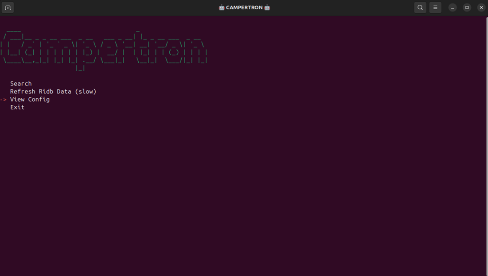

<div align="center">
<a href="https://github.com/ShaunAnthonyHathaway/Campertron">
  
</a>
</div>
Campertron is a campsite tracking application that can help you find available campsites on recreation.gov as they become available. You can run on most platforms or as a container and setup email notifications when a site is open for booking.  Plans change and campsites open up constantly but if you aren't watching closely you will miss it.  Use Campertron so you don't miss those opportunities to make it to your desired destination!

---

## Download and Run

1. Grab the [release for your platform](https://github.com/ShaunAnthonyHathaway/Campertron/releases). From 0.1.0-beta.4 on, every platform has two archives: `campertron-console-<version>-<platform>` (search and notifications) and `campertron-gui-<version>-<platform>` (campground lookup). Windows archives are `.zip`; Linux and macOS archives are `.tar.gz`. Platforms: Linux x64, arm64 and arm; macOS arm64 and x64; Windows x64, x86 and arm64. No .NET installation is needed.
2. Extract, Run CampertronConsole, and enjoy!

**Versions from 2024 (`v0.1-beta1`/`v0.1-beta3`):** don't keep them next to a newer version. All versions use the same data folder (`CampertronConfig`). The database that 0.1.0-beta.4 and later install, and any database refreshed from current RIDB data, keeps ZIP codes in a column the 2024 versions read as the state, so a 2024 GUI lists ZIP codes such as `01005` as states. The 2024 archives have no top-level folder (an extraction tool usually names the folder after the archive, for example `campertron-linux-x64`); from 0.1.0-beta.4 on, each archive contains one folder named `campertron-<console|gui>-<version>-<platform>`. To check which version a copy is: `CampertronConsole --version` or `CampertronGUI --version` print the version and the .NET runtime (versions after 0.1.0-beta.4). In any version, the console's **View Config** shows `Framework => .NET 10` for 0.1.0-beta.4 and later, and an older .NET (.NET 9 for `v0.1-beta3`) for the 2024 versions.

Each release includes `SHA256SUMS.txt` (`sha256sum -c SHA256SUMS.txt --ignore-missing`) and GitHub build-provenance attestations (`gh attestation verify <file> --repo ShaunAnthonyHathaway/Campertron`). The binaries are not code-signed. On macOS, remove the quarantine attribute (`xattr -dr com.apple.quarantine <folder>`) if Gatekeeper blocks them.

<a href="https://github.com/ShaunAnthonyHathaway/Campertron">
  

<a href="https://github.com/ShaunAnthonyHathaway/Campertron">
      

## Configure

The first time you run Campertron a sample configuration file is automatically generated for you.  Multiple configuration files can be used and Campertron will search against them all when it runs.  Campertron will only grab the data it needs for all of your configuration files once and it can search against them in parallel.  You can view the directory path that the configuration files are stored in with the **View Config** menu option.

<a href="https://github.com/ShaunAnthonyHathaway/Campertron">
      

<a href="https://github.com/ShaunAnthonyHathaway/Campertron">
   

Example configurations and instructions can be [found here](https://github.com/ShaunAnthonyHathaway/Campertron/tree/master/examples/0.1)

Additionally you can run CampertronGUI to get the campground ID and other information about the locations.

<a href="https://github.com/ShaunAnthonyHathaway/Campertron">
  

## Docker

1. Follow the [Docker official installation guide](https://docs.docker.com/engine/install)
2. Download the container image from the GitHub Container Registry, for linux/amd64 and linux/arm64. Use the version you want; the first image published there is `0.1.0-beta.4`. Prereleases are only tagged with their exact version. `latest` points to the newest stable release once one exists.

```commandline
docker pull ghcr.io/shaunanthonyhathaway/campertronconsole:0.1.0-beta.6
```

The older Docker Hub image `shaunhathaway/campertronconsole` is an old 2024 build and is no longer updated. Current users should use the versioned GHCR image shown above instead.

3. Create either persistent storage or persistent volumes for the configuration and cache data.

Persistent storage:

```commandline
mkdir /path/to/config
mkdir /path/to/cache
```

Persistent Volume:

```commandline
docker volume create campertron-config
docker volume create campertron-cache
```
4. Create and run the container:

Persistent storage:

```commandline
docker run -d --name campertron --volume /path/to/config:/config --volume /path/to/cache:/cache ghcr.io/shaunanthonyhathaway/campertronconsole:0.1.0-beta.6
```

Persistent Volume:

```commandline
docker run -d --name campertron --volume campertron-config:/config --volume campertron-cache:/cache ghcr.io/shaunanthonyhathaway/campertronconsole:0.1.0-beta.6
```
